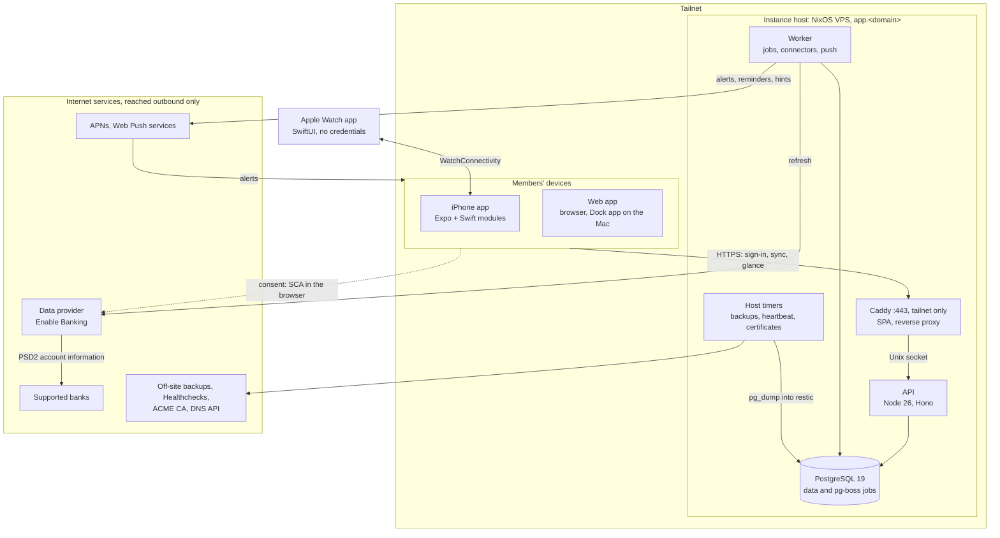

# Architecture

## Scope and sources

This is the map to read first: what Shoestring is made of, how data moves through it, and where each decision is written down. It describes the target as of 2026-11-08. No code exists yet, and the [spikes](#spikes) may still change parts of it. Decisions live in the [ADRs](adr/), behavior and numbers in [`SPEC.md`](../SPEC.md), tooling, CI and releases in [`factory.md`](factory.md); this file links to them rather than restating them.

- **Precedence.** [`PRODUCT.md`](../PRODUCT.md) and the ADRs record the maintainer's decisions and win; then `SPEC.md`; then `factory.md` for tooling and this file for the runtime design; then the research notes under `docs/research/`. The notes are background: follow one only where an ADR, `SPEC.md`, `factory.md` or this file adopts it, and read its recommendations through [Resolved conflicts](#resolved-conflicts). Notes written before the 2026-11-07 decisions may assume SwiftUI apps, a public host, a hosted service for friends or the AGPL; the ADRs override them. The notes keep their facts and aren't rewritten to match.
- **Vocabulary.** Terms follow [`GLOSSARY.md`](../GLOSSARY.md).
- **Placeholder.** `app.<domain>` stands for the instance address: any HTTPS hostname its owner controls, such as a subdomain of a domain they already own. It never changes ([ADR 0011](adr/0011-passkeys-on-the-instance-sign-in-page.md)) and doesn't depend on the product name.
- **Public repository.** People appear by role and banks as supported banks; personal details and plaintext secrets stay out ([`AGENTS.md`](../AGENTS.md)).

## System context

The diagram shows the reference deployment; another instance may sit on any private network.

- **One owner per instance.** The owner creates isolated households, such as a test household and a production household, and adds members by invite. There is no public sign-up ([ADR 0001](adr/0001-self-hosted-single-owner-instances.md)).
- **No inbound connection from the internet.** Every feature works on an instance reachable only over a private network ([ADR 0003](adr/0003-nixos-just-tailscale-infrastructure.md)). Refreshes through the data provider, APNs and Web Push, off-site backups, dead-man pings and DNS-01 renewals are outbound.
- **Bank consent is a browser navigation.** The owner's browser goes to the data provider and the bank's SCA, then returns to `app.<domain>` over the private network.
- **The watch has no path of its own.** It reaches the instance only through the paired iPhone ([ADR 0006](adr/0006-watch-shows-a-glance-relayed-by-the-iphone.md)).
- **In the reference deployment, the tailnet is the boundary:** see [The reference deployment](#the-reference-deployment).

## Components

### Clients: iPhone, web and Mac

- **One Expo app** (`apps/client`; Expo SDK 58, React Native 0.88) serves the iPhone and the web ([ADR 0004](adr/0004-expo-react-native-for-iphone-web-and-mac.md)): Expo Router with native tabs, Expo UI SwiftUI controls where system behavior matters (each with a `.web.tsx` variant), react-native-web with `web.output: 'single'` served by the instance as an installable PWA, and Unistyles themes generated from the design tokens.
- **Native project.** A committed `ios/`: one `expo prebuild`, then owned in Xcode (classic `.xcodeproj`, CocoaPods). Continuous Native Generation returns only if its path passes SP-03. No over-the-air updates (`expo-updates` off) and no EAS ([ADR 0005](adr/0005-swift-where-ios-needs-it-in-a-committed-ios-project.md)).
- **Floors.** iOS 26.0 and watchOS 26.0, where complications refresh only while the watch app runs (`SPEC.md` Apple Watch). On the web: Safari and iOS 26+, current Chrome, Edge and Firefox.
- **Mac in v1.** The Safari Dock web app. The iPad app on the Mac only if SP-08 shows the Dock app losing data; react-native-macos once 0.86 or later ships with Expo support.
- **Local storage.** A device keeps one SQLite database per household, its local copy, each with its own outbox, cursor and client ID. iPhone: `expo-sqlite` with SQLCipher in the app's own container. Web: the official SQLite WASM on `opfs-sahpool` in one leader worker per browser profile (Web Locks, BroadcastChannel), one pool per profile, which holds one person's data ([ADR 0009](adr/0009-build-the-sync-engine-in-typescript.md); `web-client-sync.md` §2, §3.4). Both share one schema; see Client schema changes under [Client mutations and sync](#client-mutations-and-sync).

### Watch and Swift modules

| Piece | Job | Note |
|---|---|---|
| Watch app (SwiftUI companion) and its WidgetKit extension | Shows the read-only glance of the selected household: safe to spend, daily budget, days left and pace for both plans; one complication family without amounts, which on watchOS 26 refreshes only while the app runs; hide amounts; dark only. Later: review, a limits page, more families, a Smart Stack widget. Never on the wrist: allocation, settings, bank connections, splits | `SPEC.md` Apple Watch; `watchos-app.md` §2, §3.2 |
| `Security` Expo module | Ephemeral `ASWebAuthenticationSession` sign-in (`.customScheme` Callback API), Keychain items, native token refresh, app lock, a biometry-bound Secure Enclave key for step-up | [ADR 0011](adr/0011-passkeys-on-the-instance-sign-in-page.md); `cross-platform-ui-stack.md` §4.8 |
| `WatchRelay` Expo module | `WCSession` activated from an `ExpoAppDelegateSubscriber`, the glance cache and a native `GET /api/v1/glance`, its own `BGAppRefreshTask`, and the watch's hide amounts setting mirrored into the app group; later, watch actions posted to one idempotent endpoint | [ADR 0006](adr/0006-watch-shows-a-glance-relayed-by-the-iphone.md); `watchos-app.md` §2.4 |
| Notification service extension | Decrypts payloads with the per-device key, renders their text from the generated Swift catalog, and drops amounts when the iPhone's or the watch's hide amounts is on | [ADR 0015](adr/0015-one-message-catalog-for-every-platform.md); `i18n-l10n.md` §6 |
| App Intents extension (Next) | `RecordWalletTap` and `AddCash` append captures to an app-group handoff file | `cross-platform-ui-stack.md` §4.4 |
| iOS widgets (Next) | Read the glance only | |
| Swift packages | `DesignSystem` and `Strings` (generated), `WatchBridge` (glance codec and its (epoch, cursor) rule) | `apple/Packages/` |

Not used: `expo-web-browser` for sign-in, `expo-app-intents` (alpha), `react-native-watch-connectivity`, `@bacons/apple-targets`. No share extension in v1.

### Domain and sync packages

- **`packages/domain`**: money and time types, the budget engine (safe to spend, daily budget, pace, rollover, shares, limit states), the named and versioned mutators, GlanceBuilder, the regional-preferences resolver, and golden JSON vectors. Pure TypeScript, run by the server and by the iPhone and web apps.
- **`packages/sync-core`**: outbox, push, pull and apply, the client SQLite schema and its re-bootstrap on schema changes, behind `SqlDriver`, `Transport`, `Auth` and `Clock` ports that the iPhone's JS thread and the web leader worker inject ([ADR 0008](adr/0008-server-authoritative-sync-with-named-mutations.md); `sync-engine.md`, `web-client-sync.md` §3).
- **Access model** ([ADR 0010](adr/0010-spaces-for-access-and-sync.md)). Every record belongs to exactly one space: a member's personal space or the household's shared space. A member accesses their own personal space and their household's shared space, nothing else, and nothing crosses households. Sharing an account moves it and its transactions into the shared space, and no shared-space row references a personal-space row: the category, note and plan of a shared account's transaction that counts in a private plan live in an annotation row in its member's personal space. A visibility change moves rows under one sync ID and re-bootstraps every device of the household. The instance owner is the only administrative role.
- **Domain records.** Accounts (bank or manual, with account holders); transactions (booked, pending, provisional entries, manual entries) with their category lines; plans with their categories, allocations, limits, rollover rules and goals; recurring items and their occurrences; money owed (debts, expected reimbursements, settlements), always one member's; and contributions, shared entries and member balances. Loans with a schedule come just after the MVP.

### Server

One Node 26 package, `apps/server` ([ADR 0007](adr/0007-typescript-server-on-node-with-hono-drizzle-and-postgresql.md)), with these entry points (`web-client-sync.md` §3.5, `nixos-vps-infra.md` Services):

- **API.** Hono 5 on its Node adapter, `@hono/node-server`, on a socket-activated Unix socket behind Caddy. It serves sync (bootstrap, pull, push and the `live` SSE poke stream), the glance, `meta` and `/up`, the OAuth 2.0 authorization server (oidc-provider) with passkey ceremonies (SimpleWebAuthn), invites, the owner's administration endpoints and the bank callback. It runs with no network beyond local sockets, so it enqueues consent starts, code exchanges and explicit refreshes as pg-boss jobs and waits for the worker's results.
- **Worker.** A separate process on pg-boss jobs (graphile-worker as fallback): the jobs below, the connectors, APNs (@parse/node-apn) and Web Push (web-push). The only process holding the KEK and the APNs and VAPID keys.
- **Migrator.** The `shoestring-migrate` oneshot: a pre-migration dump, then forward-only SQL migrations under an advisory lock, each recording the schema's floor ([ADR 0018](adr/0018-forward-only-upgrades-with-a-client-support-window.md)).
- **Host CLI** (`shoestring <command>`): `bootstrap`, `recover-owner`, `restore`, `backup-verify`, `doctor` and `secrets-generate`. Test households fill from the owner's administration, not from the host.
- **Data access.** Drizzle ORM 1.0 for typed queries. Schema changes are reviewed SQL files (drizzle-kit may draft them), linted by squawk and embedded in the package. No Bun. An OpenAPI document comes with the watch actions endpoint; until then the glance's golden JSON is the only Swift contract.

### Database

- Vanilla PostgreSQL 19, no extensions, set explicitly on NixOS. Unix socket only, with peer auth and separate roles for migrations, the API and the worker; only the worker reads encrypted credentials. Supported majors: 19 only, until 20 (`nixos-vps-infra.md` Database and backups, `self-hosting.md` §3.4).
- Sync tables: one instance-wide `sync_counter` row, the instance epoch, `spaces`, `memberships`, `clients` (one per local copy) and `change_log` keyed by `(sync_id, seq)` with `space_id` (`sync-engine.md` Minimum viable protocol).
- Every row carries `household_id` and `space_id`, and row-level security by household backs the server's checks. Annotation fields keep their source and the sync ID of their last change on the server only. Amounts are `bigint` plus `char(3)`; instants `timestamptz`; civil dates `date`. Search runs on devices, over their local copies; PostgreSQL holds no search key.

### Jobs

- **Refresh.** Refresh slots under the fetch budget, whose unit, the access, `SPEC.md` defines (Bank connections); the backfill right after each consent; consent-expiry alerts at T−14, T−3 and T−0 days.
- **After each committed account batch** (a refresh or an import), in order: categorization rules (source `rule`, never over a member's choice), pending-to-booked pairing, provisional-entry matching within 0–5 days, transfer and cash-withdrawal detection, suspected duplicates from files, occurrence matching, settlement suggestions, recurring-item detection for the payees the batch touched, then alert evaluation. Recurring detection also runs nightly over every account.
- **After each applied push** that changes a plan's spending, allocations or attribution: alert evaluation for that plan, at most once a minute per plan. An hourly sweep checks thresholds and pace.
- **Where suggestions live.** Each suggestion is an inbox item in the space of the records it links: a member's personal space when it touches a private record, else the shared space, where one holder's confirmation clears it. Detection pairs only records one member can see, so no suggestion links two members' private records ([ADR 0010](adr/0010-spaces-for-access-and-sync.md)).
- **Push.** Alerts; due reminders by Web Push to the member's web devices (iPhones schedule reminders as local notifications); "glance changed" hints coalesced to two or three an hour. A test household's alerts and reminders stay off unless the owner turns them on.
- **Retention.** Purges of raw provider payloads.
- **Host timers** (systemd): hourly backups, a weekly `restic check`, a monthly scripted restore check, a 5-minute heartbeat, weekly garbage collection and a nightly reboot-if-needed (`nixos-vps-infra.md` Jobs).

### Connectors

- `packages/connectors`: a TypeScript connector SDK with a static registry (connectors are built in, never loaded at runtime), typed errors and a contract kit run against a fake provider (`connectors-and-license.md` §5).
- v1: Enable Banking through the owner's own provider application ([ADR 0012](adr/0012-bank-data-through-the-owners-provider-application.md)), plus OFX 1.x and 2.x, QIF, and CSV with one import profile per supported bank, for other members and for banks it can't read. Later: contracted data providers, token providers, e-mail ingest. Never: scraping, FinanceKit.
- The core owns scheduling, the fetch budget, dedupe, storage, sharing and notifications. A connector only translates, and sees its member's secrets but never the database.
- The file parsers run on both sides: on the device for an import preview, on the server for the import itself.

## Data flows

### Bank ingestion

1. **Setup, once, by the owner.** The instance generates an RSA-4096 key and a long-lived certificate. The owner registers a restricted production application in Enable Banking's Control Panel with that certificate and the callback URL, then pastes the application ID, and the server checks it with `GET /application` (`connectors-and-license.md` §4.1). Other members import files.
2. **Consent.** After step-up, the worker starts the consent and the owner passes SCA in the system browser: an ephemeral `ASWebAuthenticationSession` in the app, a full-page redirect on the web, never a WebView. The browser returns to `https://app.<domain>/connect/enable-banking/callback`, the state lives in Postgres and the worker exchanges the code. The app gets a custom-scheme bounce with no code in it, plus a return button and polling (§4.3).
3. **Refresh.** Background slots send no PSU headers. Only an explicit refresh (pull-to-refresh or a refresh button), and the backfill right after a consent, add the owner's PSU headers. Opening an app syncs with the instance and may use a slot left that day, but never counts as user-present (§4.5).
4. **Normalization.** The connector maps provider rows. The core gives each new transaction a random UUIDv7 and dedupes by count on a non-unique key: account, bank reference, fingerprint and rank among identical keys in the batch (`SPEC.md` Bank connections; `bank-aggregation.md` warns that some banks reuse references). It pairs pending transactions with their booked twins, models deferred-debit cards as card accounts settled by transfers, and stores raw payloads encrypted under a retention limit.
5. **Commit.** One database transaction per account batch takes the next sync ID and writes the transactions and their change-log rows; then the post-commit jobs run ([Jobs](#jobs)), devices are poked and the iPhone gets a "glance changed" hint.
6. **Renewal.** A consent lasts the bank's maximum (at most 180 days) minus a margin, computed in UTC seconds. The worker alerts the owner at T−14, T−3 and T−0 through APNs and Web Push. Renewal reattaches accounts by `identification_hash`; when a bank ends many consents at once, the owner's alert says so (§4.4).

### Client mutations and sync

1. A screen runs a named, versioned mutation such as `categorize@1`. In one local transaction, the `packages/domain` mutator updates the local view and the mutation joins the outbox, with UUIDv7 IDs for inserts, a contiguous mutation ID, the device's cursor as its base and its creation time.
2. `sync-core` pushes within seconds to `POST /api/v1/push`. For each mutation, the server skips replays, takes the next instance-wide sync ID, runs `can(person, action, record)` and the same mutator inside a savepoint, and appends change-log rows. A domain rejection still advances the queue and returns its reason.
3. The server pokes devices over the SSE stream at `/api/v1/live` (on the web, only the leader holds it), and APNs hints wake the iPhone. A device then pulls `GET /api/v1/pull` across all of its member's spaces from one REPEATABLE READ snapshot, writes the confirmed rows, drops confirmed mutations and replays the pending ones on top.
4. A new device or household starts from `GET /api/v1/bootstrap` (NDJSON from one snapshot). A cursor below the compaction floor gets `410`, and a membership or visibility change triggers a re-bootstrap; both keep the outbox.
5. **Conflicts** ([ADR 0008](adr/0008-server-authoritative-sync-with-named-mutations.md)). Annotations use per-field last-writer-wins in the order the server applies edits, behind the source rank (`user` > `rule` > `import`); an edit created more than 24 hours before it arrives loses to a change the field received after the edit's base cursor. Reallocations, category-line sets (one value), matches and deletes are server operations. Derived numbers are recomputed on each side and never synced (`sync-engine.md` §4).
6. **Versions.** The server accepts the previous minor's mutation versions, glance version and watch contract for at least 90 days, publishes `minClientVersion` and `features` at `/api/v1/meta`, and answers older apps with `409 client_too_old`; they keep their outbox (`self-hosting.md` §3.3).
7. **Client schema changes.** An app whose client schema changed keeps the outbox, client ID and household of each local copy, drops the replicated tables and bootstraps again; the outbox table has its own forward-only migrations, and the app keeps the mutators of every version the server still accepts, so pending mutations replay. On the web, a tab running new code takes the Web Lock only after the old leader finishes its transaction, closes its databases and steps down; tabs on old code then reload. A test upgrades an N−1 local copy holding a pending outbox on both SQLite drivers (`web-client-sync.md` §3.3).

### Watch glance relay

1. GlanceBuilder builds glance v1 for one member of the household selected on the iPhone, from one snapshot of their spaces: `plans` keyed `personal` and `shared` (safe to spend, daily budget, pace, a status of `onTrack`, `near` or `over`) and the period end, stamped with the instance epoch and the sync cursor (`watchos-app.md` §2.4).
2. WatchRelay fetches `GET /api/v1/glance` natively, with access tokens borrowed from `Security`: on a watch request when its copy is over 2 minutes old, on a "glance changed" push, in its own `BGAppRefreshTask`, on a hint from the JS sync client, or when the iPhone switches households.
3. It sends the glance through `updateApplicationContext` and, on watchOS 27, through `transferCurrentComplicationUserInfo` while a complication is on the active face. On watchOS 26 those transfers don't reach WidgetKit complications, which refresh only while the watch app runs. It answers `sendMessage` from its cache, with no JavaScript running.
4. The watch keeps a copy only if its (epoch, cursor) is higher, and a new epoch always replaces it. It stores the copy in its app group for the widget extension and shows its age on every surface.
5. **Later, watch actions** ([ADR 0006](adr/0006-watch-shows-a-glance-relayed-by-the-iphone.md)): WatchRelay posts each action with a client-generated action ID to `POST /api/v1/watch/actions`, keeps unsent ones in a small file and retries with the same ID; the server applies the named mutation once and returns its sync ID, which the watch shows as pending until a glance reaches it or carries a new epoch.
6. **Later, App Intents captures** take the slow path on purpose: the extension appends a UUIDv7 provisional or manual entry to the handoff file, and the JS sync client drains it into `addProvisional@1` or `addManual@1` at its next run.

### Alerts and push

- The worker evaluates alerts as [Jobs](#jobs) describes, and sends consent-expiry alerts and, to web devices, due reminders. Recipients and kinds follow `SPEC.md` (Limits and alerts).
- **APNs.** Token auth with a `.p8` team key, sent only to builds signed by the same team: the maintainer's TestFlight builds from the reference instance, a self-hoster's own builds from theirs. No push relay.
- **Payloads** carry an event type and raw values, encrypted per device with a key shared only with the notification service extension, which renders the text in the device's language and regional preferences. The fallback key carries no amount, and with hide amounts on, no notification shows one (`i18n-l10n.md` §6, `watchos-app.md` §2.6).
- **Interruption.** Time Sensitive and quiet hours follow `SPEC.md` (Limits and alerts). iOS forwards alerts to a worn watch while the iPhone is locked.
- **Web Push** with VAPID, the text rendered by the service worker from the web catalog. On iOS it reaches only Home Screen web apps, with permission asked from a gesture. No declarative Web Push (`web-client-sync.md` §5.4).

### File import

1. **Entry points:** the web app's file picker and drag-and-drop (the Dock app included); on iOS, a document picker and OFX, QIF and CSV document types ("Open in"). A share extension comes later, only if needed.
2. The shared parser previews the file on the device, offline included. The preview's rows are keyed by (import ID, row index) and belong to the pending `importFile` mutation.
3. `importFile` carries the raw file. The server re-parses it with the same package, dedupes by count as above, holds rows that match a bank connection's transactions only by date and amount as suspected duplicates, and owns the rows, which replace the preview at the next pull.
4. The test household accepts only generated files. Imports don't count against the fetch budget.

### Backups and restore

1. **Every instance.** The module streams an hourly uncompressed `pg_dump`, with `pg_dumpall --globals-only --no-role-passwords`, into restic, which encrypts and deduplicates; the default repository is local, and `doctor` warns until an off-site one is configured. One retention policy: 48 hourly, 35 daily and 12 monthly snapshots. Before each migration, the migrator also writes a `pg_dump -Fc` kept locally (the last three) for a quick rollback. `shoestring backup-verify` restores the latest snapshot into a scratch database and checks invariants (`self-hosting.md` §4, `nixos-vps-infra.md` Database and backups).
2. **The reference deployment** adds two off-site EU restic repositories, one of them append-only or object-locked; see [The reference deployment](#the-reference-deployment).
3. **Restore.** `shoestring restore` loads a snapshot into an empty database and rotates the instance epoch, which every bootstrap, pull and push response and every glance carries. A device that sees the new epoch keeps its client ID and pushes its pending mutations: the server skips those at or below the restored last mutation ID as applied and accepts the first one above it, one gap per client. The device then re-bootstraps and tells its member how many acknowledged changes the restore lost (its last acknowledged mutation ID minus the restored one). Devices don't keep acknowledged mutations ([ADR 0018](adr/0018-forward-only-upgrades-with-a-client-support-window.md)). The worker treats every account's fetch budget as spent for the 24 hours after a restore.
4. **Export.** A member's export (versioned NDJSON plus CSV, no provider secrets) serves portability, not recovery. The KEK never enters a backup ([Keys and secrets](#keys-and-secrets)).

## Security model

- **Sign-in** ([ADR 0011](adr/0011-passkeys-on-the-instance-sign-in-page.md); `native-apps-auth.md` Recommendation). A built-in OAuth 2.0 authorization server, issuer `https://app.<domain>` with RFC 8414 metadata, accepts the native builds listed in the instance's configuration. Passkeys only, started from a button on one sign-in page for every device; the RP ID is `app.<domain>` and the server checks that one origin. Native apps use an ephemeral `ASWebAuthenticationSession` with PKCE S256, `state` and a custom-scheme callback, then hold a ~15-minute bearer access token and a rotating 60-day sliding refresh token; reusing a rotated refresh token revokes the device. DPoP waits for a hardening ADR. No passwords and no Sign in with Apple; external OIDC, brokered by the server, comes later.
- **Bootstrap and recovery.** An empty instance serves only a "not initialized" page. The owner starts from a single-use, one-hour link printed by the host CLI. Invites are single-use, valid 72 hours, stored hashed, and shared as a link or QR code; redeeming one registers a passkey. Members recover through the owner, and the owner through the host CLI: shell access is the root of trust (`self-hosting.md` §5).
- **Sessions and app lock.** The web uses a `__Host-` cookie (HttpOnly, Secure, SameSite=Strict), 30-day sliding, plus an exact Origin allow-list and a required custom header against CSRF. The app lock and step-up follow ADR 0011 and `SPEC.md`; step-up uses a biometry-bound Secure Enclave key in the apps and a fresh passkey on the web. Sign-in, invite redemption, bootstrap and recovery links, and step-up are rate-limited. An append-only audit log keeps 13 months; the owner sees the instance's events, and each member sees the events about their own data.
- **Device keys.** On the iPhone, the refresh token is `AfterFirstUnlockThisDeviceOnly` with no biometry flag, in the app-only access group, since no extension calls the API. Only the push-payload key is shared with the notification service extension. WatchRelay borrows access tokens from `Security`, so one refresher exists. The database lives in the app's container (`completeUntilFirstUserAuthentication`), encrypted by SQLCipher under a Keychain key; the app group holds only the glance, the watch's hide amounts setting and, later, the handoff file. The watch holds no credentials: it shows amounts only when a watch passcode is set, relies on wrist detection, and redacts amounts in Always On and in complications.
- **Server configuration.** Secrets are files (sops-nix on the reference deployment), handed to units with `LoadCredential`; the server refuses to start without them or without an `https` instance address. A development mode, which only `just dev` and the CI `web` job set and the Nix package can't enable, accepts `http://localhost` and the CI hostname.
- **Household isolation.** `household_id` and `space_id` on every row, one `can(person, action, record)` check per mutation, row-level security by household as defense in depth, and pulls limited to the member's spaces. The sync simulator checks that no row of another space or household reaches a device and that no shared-space row references a personal-space row.
- **Operator trust.** Whoever controls the host or the database can read every household and, with effort, extract provider keys. Isolation protects against members and mistakes, not the operator, and there is no end-to-end encryption, since the server refreshes, categorizes and alerts. In the apps, the owner sees a household's data only as one of its members. The self-hosting docs say so (`self-hosting.md` §6), and so does the invite page.
- **Browser data.** The browser is the least-trusted device: a hash-based strict CSP (`'strict-dynamic'`, `'wasm-unsafe-eval'`), Trusted Types, no third-party JavaScript, COOP without COEP. One person per browser profile, with persistent storage. Local data gets a PRF-wrapped key once SP-25 passes; until then, OS disk encryption behind a passkey UI gate, which the app states. Sign-out pushes pending changes, revokes the session, expires the cookie, logs out every tab over BroadcastChannel and deletes the profile's Shoestring data (OPFS pools, Cache Storage, the service worker), answering with `Clear-Site-Data: "cache", "storage"`, never `"cookies"` (`web-client-sync.md` §4).
- **Network.** The API unit runs with `PrivateNetwork`; the worker is egress-only. The reference deployment's Tailscale ACLs are under [The reference deployment](#the-reference-deployment).

### Keys and secrets

| Secret | Generated | Held by | Rotation |
|---|---|---|---|
| Key-encryption key (KEK) | `shoestring secrets-generate`, before the first start | Worker | A new KEK re-wraps every record's data key online, then the old one is retired |
| Session key | `secrets-generate` | API | Two keys for 30 days: the new one signs, both verify |
| OIDC token-signing keys | `secrets-generate`; oidc-provider's JWKS | API | A new key joins the JWKS, signing moves to it, the old one leaves after the longest token lifetime |
| VAPID key pair | `secrets-generate` | Worker | Voids every Web Push subscription; web devices re-subscribe when `/api/v1/meta` shows the new public key |
| APNs `.p8` key | Apple, in the publisher's team | Worker | A second key in the team, deployed before the first is revoked |
| Backup repository passwords | `secrets-generate` | Backup timer | A new restic key, then the old one removed |
| DNS API token (for the ACME zone only), Tailscale auth key | Their providers | Host (ACME, tailscaled) | Reissued at the provider |
| Provider application key | The instance, for the owner | Database, under the KEK | A new certificate registered with the data provider, if SP-13 shows the Control Panel accepts one |

- **When.** `secrets-generate` runs before the first start: on the deploying workstation for a sops deployment, which encrypts its output into the ops repository, or on the host for others. It prints the **emergency kit**: the KEK, the backup repository passwords, and where the sops recovery key and the DNS and Tailscale credentials live. The kit is kept offline; no backup holds the KEK.
- **Certificates.** The provider application's certificate gets the longest validity the data provider accepts; SP-13 records it and whether a replacement is accepted.
- **Compromise.** A leaked key is rotated as above; a leaked KEK also means a new certificate for the provider application, since the key it protected may be out.
- The provider key is generated on the instance and stored only in the database, AEAD-encrypted with a per-record data key bound to the owner and credential IDs; raw payloads use per-household data keys. No API returns a key, and no device holds one (`connectors-and-license.md` §4.2).

## Self-hosting and the reference deployment

### Every instance

`self-hosting.md` and `nixos-vps-infra.md` Services:

- **One flake.** `packages.default` (API, worker, host CLI, web build, embedded SQL migrations); `nixosModules.default`, i.e. `services.shoestring` (RFC 42 settings, `LoadCredential`, a local Postgres with `ensureUsers` and a supported-major assertion, backups into restic, an optional Caddy vhost, `openFirewall = false`); `checks` (unit tests and VM tests: fresh install, upgrade from the previous release, rollback to it, backup then wipe then restore with a reconnecting device, public interface closed); `templates.ops` (the ops skeleton); `devShells`.
- **Units.** The migrate oneshot, the socket-activated API (`stopIfChanged = false`, so a switch queues connections instead of refusing them) and the worker, all hardened except `MemoryDenyWriteExecute`, which Node's JIT breaks (SP-04 measures `--jitless`).
- **Releases** ([ADR 0018](adr/0018-forward-only-upgrades-with-a-client-support-window.md); [`factory.md`](factory.md) Releases). `vX.Y.Z` tags, no channels and no backports. Migrations are expand/contract and record the schema's floor; a server refuses a schema whose floor is above its version, or an unsupported Postgres major. The server updates first, and native builds reach devices only after it.
- **Reach.** Every feature works on an instance reachable only over a private network; Tailscale, Headscale, WireGuard or a LAN all qualify. The watch reaches the instance only through its iPhone.
- **Native apps** ([ADR 0019](adr/0019-native-apps-through-the-testflight-internal-group-only.md)). The maintainer's TestFlight internal group for the maintainer's household; other self-hosters use their instance's web app, or follow a build-from-source guide with their own team ID, bundle ID, app group, URL scheme and APNs key from untracked config (`native-apps-auth.md` §8).
- **Observability.** No telemetry. `/up`, `/api/v1/meta` and `doctor`, which also warns when no off-site backup repository exists. The owner's screens show instance health, backup status, the instance's audit events, and the owner's bank connections with their health and last successful refresh. Logs never carry transaction payloads, tokens or bank identifiers. Apps show their unsynced-change count; the watch shows the glance's age.
- **Later.** An OCI image and a release-pinned compose bundle, built from the same flake with no Dockerfile, once the server is stable (SP-33).

### The reference deployment

[ADR 0003](adr/0003-nixos-just-tailscale-infrastructure.md) decides it; these are the ops template's defaults, which any self-hoster may adopt. The maintainer's actual values live only in the private ops repository (`nixos-vps-infra.md` Proposed target infrastructure).

- **Ops repository.** Private, made from `templates.ops`. Inputs: nixpkgs on `nixos-unstable`, with rolling updates (Updates below), Shoestring pinned to a release tag and built against its own nixpkgs (no `follows`, so the release build's hash matches the cache), sops-nix, disko and deploy-rs.
- **Host.** One x86_64 EU KVM VPS (at least 2 vCPU, 4 GB, 40 GB, IPv4 and IPv6), installed with nixos-anywhere and disko from a pre-generated host key, so secrets decrypt on first boot. The node is tagged `tag:prod`.
- **Exposure.** The firewall admits only Tailscale's UDP port on the public interface and opens 443 and 22 only on `tailscale0` (`networking.firewall.interfaces.tailscale0`), with `services.openssh.openFirewall = false`. sshd and Caddy listen on every address, so the firewall is the gate: a VM test checks that 22 and 443 stay closed publicly, and the provider's firewall, admitting only Tailscale, is a second layer. Nothing is published, not even an association file, and there is no Cloudflare Tunnel, which would add a public path and decrypt every request at a third party.
- **Members' access.** Members join the owner's tailnet as users, which costs nothing for a household (unverified: check the plan's current user limit), and ACLs give the owner's devices 22 and 443 on `tag:prod` and members' devices 443 only; `tag:ci` gets 22 only once CI deploys exist. SP-06 checks the onboarding.
- **Ingress.** Caddy serves `app.<domain>`: the SPA from the Nix store for every path not routed to the API socket ([Resolved conflicts](#resolved-conflicts), instance routes). Its certificate comes from ACME DNS-01 (lego through `security.acme`, `useACMEHost`); A and AAAA records point to the Tailscale addresses, plus a CAA record. When the domain serves anything else, `_acme-challenge.<host>` is a CNAME to a zone used only for ACME challenges, which lego and the CA follow, so the host's DNS token can't change the rest of the domain.
- **Secrets.** sops-nix, encrypted to the maintainer's age key, an offline recovery key and the host key, from `secrets-generate`'s output ([Keys and secrets](#keys-and-secrets)).
- **Builds and deploys.** Shoestring's CI builds each release tag's package and pushes it to the project's public Cachix cache. `just deploy` runs deploy-rs from a workstation, a Mac included, building the system on the VPS, which substitutes Shoestring from Cachix and the rest from the NixOS cache; building Shoestring on the VPS is the emergency path, whose peak memory SP-05 measures. Magic rollback has a 60–120 s confirm timeout, after one harmless deploy-rs deploy following the install, and is turned off for a release whose notes say it raises the schema floor, since the previous release couldn't start on the migrated schema. `just rollback` returns to the previous generation when the floor allows it; otherwise rolling back means the previous release plus the pre-migration dump. A VM test deploys N over N−1, forces a magic rollback and checks that N−1 serves. Deploys run by hand for now, since CI deploys would need GitHub Pro on the ops repository (`factory.md` Deploys).
- **Backups.** The module's restic stream goes to two EU repositories: an SFTP storage box with snapshots, and a second provider with append-only mode or object lock. The host can append there but not delete: pruning to the shared retention policy runs from a separate trusted machine with its own credentials, or through the target's object-lock retention and a lifecycle rule, and pings a dead-man check. The RPO is one hour while the off-site snapshots succeed.
- **Drills.** A monthly scripted restore check, and a quarterly rebuild drill on a throwaway VPS, each pinging Healthchecks.
- **Rebuild runbook.** Install the new VPS, join it as `tag:prod`, update the A and AAAA records to its Tailscale addresses through the DNS API, issue the certificate, restore the newest off-site snapshot, and check `/up` through `app.<domain>`; the drill rehearses it on a drill hostname. The instance address never changes, so passkeys survive.
- **Updates.** Rolling, behind a safety net: a weekly update PR in the ops repository, gated by the host VM test, then a deploy with magic rollback; a nightly timer reboots only when the running kernel changed.
- **Monitoring.** Healthchecks dead-man checks: the heartbeat, the worker cycle, each backup repository, the pruning job, the restore check, and `OnFailure=` for every unit. The heartbeat script checks the system state, disk below 80 %, a certificate valid for over 14 days, `pg_isready` and `/up` through `app.<domain>`. journald keeps 30 days.

## Repository layout

[`factory.md`](factory.md#workspace-layout) owns the layout, the checks, the CI jobs and the releases. Two rules of the runtime design constrain it:

- **Dependency direction.** `packages/domain` depends on no platform. `sync-core` and `connectors` build on it. `apps/server` never imports UI packages, and connector provider code runs only there. `WatchBridge` decodes the glance that `packages/domain` builds, pinned by its golden JSON.
- **Generated code.** `design/` and `l10n/` are the sources. Their outputs in `packages/design-system`, `packages/l10n` and `apple/Packages/{DesignSystem,Strings}` are committed, and CI fails on drift.

## Cross-cutting rules

- **Money** ([ADR 0017](adr/0017-money-in-minor-units-time-in-the-household-zone.md)). An Int64 count of minor units plus an ISO 4217 code: a branded safe-integer number in TypeScript (checked with `Number.isSafeInteger`, never `bigint` or a float), `Int64` in Swift, `bigint` plus `char(3)` in Postgres. Provider decimal strings are parsed exactly, and a surplus decimal holds the transaction for review. Splits use the largest remainder. Each household has one base currency; foreign-currency accounts, and their conversion rules, come later. Sync IDs and other 64-bit values travel as strings (`i18n-l10n.md` §5, §7).
- **Time.** Instants in UTC; civil dates as `YYYY-MM-DD`; budget months as `YYYY-MM`. The household time zone defines today, periods (from the first of the month to the first of the next), pace and due dates. SQL filters and sums civil-date ranges; every local-time-to-instant conversion, every "today" and every DST-sensitive schedule runs in TypeScript or Swift with Temporal's `compatible` policy. Native Temporal on Node 26, `temporal-polyfill` wherever it is missing (`i18n-l10n.md` §4).
- **Budget engine.** Pure TypeScript in `packages/domain`, run by the server for alerts and the glance and by the apps for screens, pinned by golden vectors. Derived numbers are never synced as truth (`sync-engine.md` §4).
- **Strings and formats** ([ADR 0015](adr/0015-one-message-catalog-for-every-platform.md), [ADR 0016](adr/0016-synced-regional-preferences-resolved-alike-everywhere.md)). One ICU catalog, `l10n/messages/{en,fr}.json`, in a restricted subset; English is the source, and French ships in the same PR, reviewed by the maintainer. A generator emits typed FormatJS modules and Swift catalogs. No literal UI text; field-based date formats; one TypeScript resolver for regional preferences, whose resolved locale tag the glance and push payloads carry to the Swift targets; the full FormatJS polyfill set on Hermes (`i18n-l10n.md` §7).
- **Design system** ([ADR 0014](adr/0014-design-tokens-and-component-specs-generate-every-platform.md)). DTCG 2025.10 tokens in `design/tokens/` (`ref.`, `sys.` and `comp.` tiers), generated by Terrazzo for five permutations to start: light and dark on iOS and the web, dark on watchOS. Components take tokens only; each `spec.md`'s YAML front matter lists the variants, which generate TypeScript enums, and Swift ones for components the watch or widgets use; lint bans raw values, and WCAG 2.2 AA blocks in every permutation. Money is never shown by color alone, and every money component honors hide amounts (`design-system.md` §5, §6; `cross-platform-ui-stack.md` §8).
- **Dependencies.** App builds ship only permissive or MPL dependencies, which a license check enforces ([ADR 0013](adr/0013-mit-license.md)). Supply-chain settings are in `factory.md`.
- **Fixtures.** Synthetic only: no real bank data enters the repository, and CI rejects non-synthetic fixtures.
- **Permanent identifiers.** Bundle IDs, app group, Keychain service and access groups, the URL scheme, token prefixes and `$extensions` keys use `shoestring` ([ADR 0020](adr/0020-shoestring-as-the-product-name.md)) and are fixed before the first TestFlight build. The RP ID is the instance address, which each owner picks before the first passkey registration; nothing in a build depends on it. Repository, package and CLI names can change later.

## Resolved conflicts

Where this file departs from a research note. Decisions recorded in an ADR are cited, not restated.

| Topic | Resolution | ADR or note |
|---|---|---|
| Instance exposure | Every instance works on a private network, with nothing inbound from the internet; the reference deployment is Tailscale-only and publishes nothing; no watch direct mode | ADR 0003, ADR 0006; voids `apple-client-stack.md` §4.4 |
| Passkey RP ID | `app.<domain>`, the exact host of the SPA, API, OAuth pages and bank callback; one origin checked; no parent RP ID, association file, static host or split DNS | ADR 0011; `web-client-sync.md` §4.2; amends `native-apps-auth.md` §9, `nixos-vps-infra.md` Ingress |
| Native sign-in and tokens | Browser-sheet passkeys; bearer tokens, with DPoP deferred; refresh token in the app-only access group; WatchRelay borrows tokens from `Security` | ADR 0011; amends `native-apps-auth.md`, `cross-platform-ui-stack.md` §4.8; supersedes `apple-client-stack.md` §3.3 |
| Web storage and logout | One person per browser profile; sign-out deletes the profile's data with `"cache", "storage"`, never `"cookies"`; several people per profile and memory-only mode later | `SPEC.md` Web; amends `web-client-sync.md` §4.6, `native-apps-auth.md` §9 |
| Watch reads and writes | Read-only watch in the MVP; actions later through one idempotent endpoint; no relay sync client; glances ordered by (epoch, cursor) | ADR 0006; amends `watchos-app.md` §2.5, `cross-platform-ui-stack.md` §4.4, `native-apps-auth.md` §10 |
| Watch lock | No exception needed: the watch holds no credentials; passcode, wrist detection, redaction, hide amounts | `watchos-app.md` §2.8 |
| Sync engine | Built in TypeScript; PowerSync not adopted unless SP-09 fails | ADR 0009; amends `sync-engine.md`, `web-client-sync.md` §3, `nixos-vps-infra.md` (container path) |
| Sync conflicts | Arrival-order last-writer-wins behind the source rank, with the 24-hour stale-edit rule; no hybrid logical clock | ADR 0008; amends `sync-engine.md` §4 and its client clock |
| Backend stack | Node 26 LTS, Hono 5, Drizzle 1.0, PostgreSQL 19, oidc-provider, SimpleWebAuthn, pg-boss worker, web-push, @parse/node-apn; no Bun | ADR 0007; supersedes `apple-client-stack.md` §4.1 |
| Access model | Spaces, not ledgers; `can(person, action, record)` plus RLS; no shared-space row references a personal-space row | ADR 0010; supersedes `apple-client-stack.md` §3.3, `self-hosting.md` §5.2 roles |
| Money owed | Debts, loans and expected reimbursements, always one member's; net cost, settlement by matching payment; on shared spending, the member who divides the payment holds the counterparties' shares and advances them from a joint account as a contribution; contributions, shared entries and member balances; contribution planner later | `SPEC.md`; amends `budgeting-products.md` v1 |
| Safe-to-spend horizon | The end of the plan's period; a payday only shapes income forecasts | `SPEC.md`; `PRODUCT.md` Budget engine |
| Test household | `kind=test`, banner, generated data and files, no bank connections, filled from the owner's administration, for trying features; upgrades are rehearsed on a throwaway instance restored from a backup | `self-hosting.md` §5.2; `nixos-vps-infra.md` Staging |
| Owner's view of bank connections | Only the owner has bank connections (ADR 0012); audit events about a member's data go only to that member | `SPEC.md` Households; amends `connectors-and-license.md` §4.2, §4.4 |
| Provider keys | The owner's only, generated on the instance, database only, bound to the owner and credential IDs; the KEK, worker only, is the only bank-related host credential | ADR 0012; supersedes `bank-alternatives.md` §1.2 option 3 and `nixos-vps-infra.md`'s provider key file |
| User-present fetch | Only an explicit refresh and the post-consent backfill send PSU headers, for that member's consents | ADR 0012; amends `bank-aggregation.md` Refresh cadence design |
| Fetch budget | An access is one request to an account endpoint, each page counted; 2 slots, the second transactions only, leaving one retry; at most 4 per account per trailing 24 h; more only after SP-13 | `SPEC.md`; amends `nixos-vps-infra.md` Jobs (per endpoint, 3 slots), `connectors-and-license.md` §4.5 |
| Transaction IDs and dedupe | Random UUIDv7 IDs; non-unique dedupe keys with ranks, by count; import previews keyed by (import ID, row index) | `SPEC.md`; amends `sync-engine.md` (UUIDv5 bank rows), `bank-aggregation.md` §8, `connectors-and-license.md` §5.2 |
| Import entry points | Web picker and drag-and-drop, iOS document picker and "Open in"; share extension later; no watched folder before a native Mac app | Amends `bank-aggregation.md` §8 |
| Regional preferences | Stored {region, hourCycle, firstDayOfWeek, and languageTag for the web}, each auto or explicit; Apple UI language from the bundle; currency from the household; one TypeScript resolver | ADR 0016; supersedes `cross-platform-ui-stack.md` §9 |
| Intl, Temporal, push text | Full FormatJS set on Hermes; date math out of SQL; push text rendered on the device; no declarative Web Push | ADR 0015; amends `cross-platform-ui-stack.md` §4.6, `web-client-sync.md` §3.3 |
| Search | On devices only; no PostgreSQL search key | Amends `i18n-l10n.md` §7 (SP-32 dropped) |
| Derived numbers | Pure TypeScript in `packages/domain`; SQL fetches and sums; SQLite views only as an optional optimization on devices | ADR 0007; amends `web-client-sync.md` §3.3 |
| Money in TypeScript | Branded safe-integer `number`, never `bigint`; 64-bit IDs as strings | ADR 0017; amends `connectors-and-license.md` §5.2 |
| Web SQLite | Official SQLite WASM on `opfs-sahpool` in the leader worker; `expo-sqlite` with SQLCipher on iOS | ADR 0009; supersedes `cross-platform-ui-stack.md` §10 |
| Client migrations | A schema change keeps the outbox and re-bootstraps the rest; the web leader hands over before old tabs reload | ADR 0009; amends `web-client-sync.md` §3.3 |
| Restore semantics | Epoch plus one mutation-ID gap per client; acknowledged mutations not kept; fetch budget spent for 24 h | ADR 0018; amends `self-hosting.md` §4's optional narrowing |
| Rollback | Schema floor per migration; magic rollback off for floor-raising releases | ADR 0018; amends `self-hosting.md` §3.1 (refuse newer schema) |
| Backups | One restic path fed by an uncompressed `pg_dump`; local `-Fc` dumps only before migrations; pruning off the host | Amends `self-hosting.md` §4 (age-encrypted dumps), `nixos-vps-infra.md` Database and backups |
| Instance routes | `/api/v1/{bootstrap, pull, push, live, glance, meta, …}`, later `/api/v1/watch/actions`, `/oauth/*`, `/.well-known/oauth-authorization-server`, `/join/*`, `/connect/enable-banking/callback` and `/up` to the API socket; the SPA elsewhere | `web-client-sync.md` §5.2; amends `nixos-vps-infra.md`, `watchos-app.md` and `sync-engine.md` paths |
| Names | `MoneyAmount`, `BudgetMeter`, `PlanPicker` (was `ScopePicker`) and the rest of `design-system.md`'s set; budget states `onTrack`, `near`, `over`; `budget.unallocated`; `--ds-` CSS prefix; modules `Security` and `WatchRelay` | `design-system.md` §1.3, §5.1; amends `watchos-app.md` §2.4, §4 and `cross-platform-ui-stack.md` §8 |
| Mac client in v1 | Safari Dock web app; iPad app on the Mac only if SP-08 shows data loss; no macOS archive in v1 | ADR 0004; supersedes macOS archives in `factory-ci-quality.md` |
| Native distribution | Internal TestFlight group only, builds added after the deploy; build-from-source guide for others; no App Review, demo mode or push relay | ADR 0019; supersedes `apple-client-stack.md` §5 |
| License | MIT; no App Store permission, SPDX additions, CLA or DCO; no trademark policy; license check | ADR 0013, ADR 0020; supersedes `connectors-and-license.md` §6 |
| Working name | Never in permanent identifiers, which use `shoestring` (see Cross-cutting rules) | ADR 0020; `native-apps-auth.md` Recommendation 1; amends the notes' URL scheme, CSS prefix and bundle ID, which use the working name |
| Email | None in the MVP: invites and recovery as links or QR codes | `self-hosting.md` §5.2; amends `i18n-l10n.md` §6 |
| GDPR | The household exemption (Art. 2(2)(c)): no consent step for data processing and no processing notice; encrypted raw payloads with a retention limit, export and deletion, and the invite page's notice about whoever runs the instance; self-hosters who use Shoestring beyond their household handle their own compliance | `SPEC.md` Security and privacy; supersedes `bank-aggregation.md` §7.2's controller advice; follows `connectors-and-license.md` §1 |
| Deploys | One `just deploy` from a workstation, by hand for now, building on the VPS and substituting release builds from Cachix; CI deploys would need GitHub Pro on the ops repository | ADR 0003; `factory.md`; amends `nixos-vps-infra.md` TL;DR 4 and CI/CD |
| OCI image and compose | NixOS module and ops template in v1; image and compose later, from the same flake | ADR 0018; amends `self-hosting.md` §2 |
| Tooling, CI and releases | `factory.md` (devShell plus `just`, Biome with GritQL plugins, release-please, tags without channels) | Amends `factory-ci-quality.md`, `design-system.md` §6, `cross-platform-ui-stack.md` §4.6, §4.8, `self-hosting.md` §3.5 |

## Spikes

SP IDs are canonical for issues. Each row names the note spikes it merges, prefixed by note: ACS (`apple-client-stack.md`), BANK, ALT (`bank-alternatives.md`), CONN, UI (`cross-platform-ui-stack.md`), DS, CI, L (`i18n-l10n.md`), AUTH (`native-apps-auth.md`), INFRA, HOST (`self-hosting.md`), SYNC, WATCH and WEB. "Blocks" lists what waits on the spike. Rows marked (human) need the maintainer's devices, banks, networks or household, and their tickets are labelled `ready-for-human`. Results that involve household devices, banks, networks or members stay in the private ops repository; the public ticket gets only the generic outcome and the decision. [`factory.md`](factory.md#build-order) places each spike in the build order.

| ID | Question | Pass if | Blocks |
|---|---|---|---|
| SP-03 (UI-S4, WATCH-W7) | Does the committed `ios/` build the watch app and every extension and reach TestFlight? | Internal build whose watch app installs and launches; extra targets link the local packages; archive under 30 Xcode Cloud minutes | SP-11, SP-12, the Apple halves of SP-15 and SP-19, SP-16, SP-17's watch part, SP-18, SP-21, SP-22, SP-30 |
| SP-04 (INFRA-S5) | Does the TypeScript server stand up as a Nix package with hardened units? | `nix build` from a clean checkout; VM boots Postgres, migrate, API, worker; zero failed requests across a switch; an expand-only release rolls back to N−1, which serves, and a floor-raising one stops N−1 with a clear error; job on time across a restart; Web Push sent | Confirms or amends ADR 0007; SP-05, SP-09, SP-10, SP-13, SP-16, SP-20–SP-22, SP-33 |
| SP-05 (INFRA-S1) | Does the reference host install, renew and deploy over the tailnet alone? | `/up` over Tailscale with a valid certificate; only Tailscale's UDP port open; deploys that break SSH revert themselves; DNS-01 renewal; secrets after reboot; a deploy substitutes the release from Cachix; peak memory of an on-VPS build recorded | Confirms or amends ADR 0003's reference deployment; SP-06, SP-11–SP-13, SP-16, SP-21, SP-22, SP-26 |
| SP-06 (human) | Can a non-technical member reach the instance from every device? | The partner gets in within 15 minutes unaided; `app.<domain>` resolves on every tested network; member devices reach only 443 under the ACL | Onboarding guide and DNS approach; any ADR 0003 amendment; SP-34 |
| SP-08 (UI-S3, WEB-W1) | Does SQLite WASM in a leader worker keep data safely in every browser target? | No committed row lost on tab kill or handover; a new-code tab takes over from an old-code leader with the pending outbox intact; eviction leads to a re-bootstrap; data kept after 8 idle days in Dock and Home Screen apps | Web storage; the Mac client (iPad app if the Dock app loses data); SP-09, SP-18, SP-24, SP-25 |
| SP-09 (SYNC-B, WEB-W7, HOST-P3) | Does the custom protocol converge on both SQLite hosts? | 10,000 seeds per driver with every invariant holding, visibility changes and the no-shared-to-personal-reference rule included; a restore recovers what devices hadn't sent; an N−1 app pushes through an upgrade; an N−1 local copy with a pending outbox survives a client schema change | Protocol amendments; reopens ADR 0009 if it fails; SP-14 offline part, SP-30 |
| SP-10 (AUTH-S2) | Does oidc-provider give PKCE and rotating refresh tokens with passkeys? | Full flow passes; reused refresh tokens, foreign origins and wrong-verifier codes rejected; no sign-up; links single-use and expiring | SP-11, SP-12, SP-24 |
| SP-11 (AUTH-S1, AUTH-S7, UI-S7, HOST-P4) | Do browser-sheet passkeys and the `Security` module work on every app? | Every app registers and uses a passkey; refresh with the app suspended and no refresh token in JS; lock after 5 minutes; step-up key bound to biometry; SQLCipher proven; sibling-host ceremony fails | SP-12, SP-21, SP-22, SP-25, SP-34 |
| SP-12 (BANK-4, CONN-3, AUTH-S4, HOST-P6) (human) | Do consents complete through the tailnet callback at each supported bank? | Consents from the iPhone and the web complete; the app regains control after the bank's app; replayed or expired state refused | ADR 0003's browser-return rule; SP-13 in-app part |
| SP-13 (BANK-1..3, CONN-2, CONN-4) (human) | What does each supported bank return, and how does it count unattended fetches? | A public-safe fact sheet per bank; how it counts accesses (per request, per endpoint or per session); an explicit refresh and the post-consent backfill with a tailnet `Psu-Ip-Address` succeed, or the bank's fallback is recorded; a week without rate limits at the chosen slots; no duplicates across overlaps or renewals; the provider certificate's validity and whether a replacement is accepted are recorded | Field mapping, dedupe keys, slots per bank; SP-30 |
| SP-14 (BANK-7, ALT-4) | Do OFX, QIF and per-bank CSV imports dedupe, offline included? | The same dedupe keys on re-parse; two identical payments in one file both import; overlapping imports add no duplicate; an offline import appears once after sync; CI rejects real fixtures | Import profiles; share-extension need |
| SP-15 (UI-S1, DS-S1, DS-S2, DS-S4) | Does one token edit reach React Native and SwiftUI? | Web half: every React Native and web output updates with no manual change, and CI fails on drift, raw colors and AA failures. Apple half, after SP-03: the Swift outputs update too | SP-16, SP-18, SP-27–SP-29 |
| SP-16 (CI-6, CI-7, INFRA-S2, HOST-P2) | Does CI cover the monorepo and the flake within budget? | TypeScript-only PR under 10 minutes; `ios/` PR under 30; secrets blocked; VM tests on free runners; ops deploy rolls back on a failed smoke test | Any later CI deploys; SP-33 |
| SP-17 (UI-S6, L2–L4, L7) | Do formats match across Hermes, browsers and the watch? | Golden vectors match bar listed differences, Foundation included with the resolved locale tag; Temporal matches Node 26 on DST days; polyfill cost fits SP-18 | SP-18, SP-20 |
| SP-18 (UI-S2) | Does the Expo app feel native on the iPhone and reach web parity? | First frame ≤ 400 ms; hitches ≤ 10 ms/s; French amount input; clean VoiceOver; web: axe, keyboard, URLs, reflow, offline reload, INP ≤ 200 ms | Per-component strategy; a hard failure goes back to the maintainer, with Capacitor as the option to put to them (ADR 0004) |
| SP-19 (L1) | Does one ICU catalog feed TypeScript and every Apple target? | Web half: identical rendering in the shared UI, and CI fails on missing French, placeholders or typography. Apple half, after SP-03: the same in the watch, widget and NSE | SP-21 |
| SP-20 (L4) | Do periods, DST days and schedules hold on the server and in the apps? | Golden tests pass for 2026-10-25 and 2027-03-28; alerts fire at local time across DST; nothing lost around midnight | Scheduler rules; budget-date fallback |
| SP-21 (AUTH-S6, HOST-P5, WEB-W6) | Do alerts and reminders reach every app from a Tailscale-only instance? | iPhone alert within 10 s, decrypted and localized; amount-free fallback; Web Push alerts and reminders on every web target; a week of background runs counted | Web alerts in v1; SP-22 |
| SP-22 (WATCH-W1, WATCH-W2) (human) | Does the relay work end to end on paired devices? | Cached glance under 1 s; a fresh one within 5 s; forwarded alerts decrypted, without amounts when the watch's hide amounts is on; after a restore, the watch takes the new epoch's glance; switching households switches the glance | Glance contract; SP-31 |
| SP-24 (WEB-W4, WEB-W5) | Does the strict CSP hold, and does sign-out wipe the profile? | Zero violations when enforced; sign-out clears OPFS, Cache Storage and the service worker | Production CSP; sign-out semantics |
| SP-25 (WEB-W3, WEB-W8) | Can trusted browsers keep encrypted offline data? | No row changed after rollback or a killed worker; nothing readable without the key; PRF matrix recorded | Web encryption path; default for browsers without PRF |
| SP-26 (INFRA-S3, INFRA-S4) | Do backups and restores meet the RPO and resist a stolen host credential? | 48 hours without a missed ping; restore with invariants under 10 minutes; the host can't delete from the append-only target, and pruning from the separate machine works; RTO measured | Backup targets; restore runbook |
| SP-27 (UI-S5, DS-S3) | System fonts or one bundled face? | No clipped digit or diacritic at the largest sizes; tabular figures align | Typeface policy (ADR 0014) |
| SP-28 (DS-S7, DS-S8) (human) | Do the palette and ownership components read without color, and do members understand pace? | Contrast and CVD checks pass; identity clear under Grayscale and VoiceOver; both members read pace correctly | Palette tokens; ownership components; pace line |
| SP-29 (DS-S5, DS-S6) | Claude Design or Figma, and does the icon pipeline work? | Tokens and components round-trip; one glyph renders as an SF symbol and a web SVG | Prototyping tool |
| SP-30 (ALT-2, ALT-3, ALT-8) | Next: which Shortcuts capture channels are reliable enough? | Handoff file drains once with the app killed; a channel ships only if it captures 9 of 10 test payments; taps match booked transactions | Capture channels; matcher rules |
| SP-31 (WATCH-W3–W6) (human) | Is the watch fresh, private and legible on device? | Median change-to-complication ≤ 15 minutes on watchOS 27, and on watchOS 26 complications current after each app open; no amount in Always On or locked; layouts fit 40–49 mm in French | Wrist privacy defaults |
| SP-33 (HOST-P1) | Only if wanted: does an image and compose bundle ship from the flake? | One tag builds an attested multi-arch image and bundle; smoke test on Postgres 19 | Second install path |
| SP-34 (AUTH-S3) | Only if SP-11 disappoints: is a per-build native passkey sheet worth a public association file? | Same passkeys in both sheets; no instance traffic leaves the tailnet | A possible ADR 0003 amendment |

Done: SP-02, Shoestring (ADR 0020).

Dropped, so don't run them: SP-01 (Enable Banking's written terms for members' provider applications: only the owner connects banks, ADR 0012; it returns if a household needs members' connections), SP-07 (PowerSync against the custom engine: ADR 0009 is accepted, and SP-09 decides), SP-23 (the Mac client: SP-08's Dock-app check decides it), SP-32 (one search key in TypeScript and PostgreSQL: search runs on devices only), the SwiftUI Mac and GRDB spikes (ACS-S1, S2), the Swift backend branches, the App Review question (AUTH-S8), watch enrollment and direct mode, the self-hosted runner, Mac sandbox and Developer ID spikes (CI-1, CI-3, CI-4) and CI-2's Mac part (its iOS and watch build numbers move to SP-03), `.xcproj` (CI-5), quotes from contracted providers and resellers (BANK-6, ALT-5 to ALT-7), the AGPL App Store exception (CONN-5), the public-host, `*.ts.net` and parent-RP-ID variants, and the macOS watched folder. `factory-v2.md`'s F1–F11 are in `factory.md`: F1 overlaps SP-03 and F2 overlaps SP-16.

## Open questions

Pending decisions live in one place each: product and platform questions in [`SPEC.md`](../SPEC.md#open-questions), repository and tooling questions in [`factory.md`](factory.md#open-questions). This file holds none.

## References

- **Product and process:** [`PRODUCT.md`](../PRODUCT.md), [`SPEC.md`](../SPEC.md), [`GLOSSARY.md`](../GLOSSARY.md), [`AGENTS.md`](../AGENTS.md), [`factory.md`](factory.md), [`docs/agents/`](agents/) (issue tracker, triage labels, domain docs).
- **ADRs:**
  - [0001 Self-hosted instances with one owner](adr/0001-self-hosted-single-owner-instances.md)
  - [0002 One UI codebase, native watch](adr/0002-one-ui-codebase-native-watch.md)
  - [0003 NixOS, just and Tailscale for the reference deployment](adr/0003-nixos-just-tailscale-infrastructure.md)
  - [0004 Expo for the iPhone, web and Mac apps](adr/0004-expo-react-native-for-iphone-web-and-mac.md)
  - [0005 Swift where iOS needs it, in a committed `ios/`](adr/0005-swift-where-ios-needs-it-in-a-committed-ios-project.md)
  - [0006 The watch shows a glance relayed by the iPhone](adr/0006-watch-shows-a-glance-relayed-by-the-iphone.md)
  - [0007 TypeScript server on Node with Hono, Drizzle and PostgreSQL](adr/0007-typescript-server-on-node-with-hono-drizzle-and-postgresql.md)
  - [0008 Server-authoritative sync with named mutations](adr/0008-server-authoritative-sync-with-named-mutations.md)
  - [0009 Build the sync engine in TypeScript](adr/0009-build-the-sync-engine-in-typescript.md)
  - [0010 Spaces for access and sync](adr/0010-spaces-for-access-and-sync.md)
  - [0011 Passkeys on the instance's sign-in page](adr/0011-passkeys-on-the-instance-sign-in-page.md)
  - [0012 Bank data through the owner's provider application](adr/0012-bank-data-through-the-owners-provider-application.md)
  - [0013 MIT license](adr/0013-mit-license.md)
  - [0014 Design tokens and component specs generate every platform](adr/0014-design-tokens-and-component-specs-generate-every-platform.md)
  - [0015 One message catalog for every platform](adr/0015-one-message-catalog-for-every-platform.md)
  - [0016 Synced regional preferences](adr/0016-synced-regional-preferences-resolved-alike-everywhere.md)
  - [0017 Money in minor units, time in the household zone](adr/0017-money-in-minor-units-time-in-the-household-zone.md)
  - [0018 Forward-only upgrades with a client support window](adr/0018-forward-only-upgrades-with-a-client-support-window.md)
  - [0019 Native apps only through the TestFlight internal group](adr/0019-native-apps-through-the-testflight-internal-group-only.md)
  - [0020 Shoestring as the product name](adr/0020-shoestring-as-the-product-name.md)
- **Research notes** (2026-11-07), background only:

| Note | Reference for | Superseded or amended |
|---|---|---|
| [sync-engine.md](research/sync-engine.md) | Protocol, simulator, invariants | Swift client side; HLC; UUIDv5 bank rows; restore semantics |
| [web-client-sync.md](research/web-client-sync.md) | Browser storage, web sessions, CSP, logout, hosting layout | §4.6 slots and memory-only mode (later); §3.3 client migrations; the dedicated domain |
| [cross-platform-ui-stack.md](research/cross-platform-ui-stack.md) | Strategy B, Swift pieces, native project, device security | §4.4 watch writes, §9 regional profile, §10 web SQLite; DPoP |
| [watchos-app.md](research/watchos-app.md) | Relay, glance, wrist privacy, watch design | MVP scope, relay client, direct mode, enrollment, glance names; the 27.0 floor, since its 26.0 fallback applies |
| [native-apps-auth.md](research/native-apps-auth.md) | Sign-in, tokens, distribution, push limits | DPoP; §9 RP ID options and `"storage"`; watch enrollment |
| [self-hosting.md](research/self-hosting.md) | Packaging, upgrades, compatibility, backups, administration, security defaults | Household roles; compose in v1; channels; refusing newer schemas; age-encrypted dumps; open license and relay; two PostgreSQL majors |
| [nixos-vps-infra.md](research/nixos-vps-infra.md) | Reference host, units, secrets, ingress, backups, deploys | Swift path, public association file, provider key file, per-endpoint 3-slot fetch budget, PowerSync container, CI deploys, the dedicated domain, release channels and their twice-yearly upgrades |
| [connectors-and-license.md](research/connectors-and-license.md) | Connector SDK, key custody, callbacks, consent lifecycle, fetch budget | §6 license; `bigint` amounts; server-only parsing; the owner's view of every connection; per-person provider applications |
| [bank-aggregation.md](research/bank-aggregation.md) | Bank coverage, data model, refresh rules, GDPR kit | Foreground refresh; device-only parsing; watched folder; §7.2's controller advice, superseded by the household exemption; per-person provider applications |
| [bank-alternatives.md](research/bank-alternatives.md) | Apple Pay tap capture, bank alerts, other routes | Friends-and-family rows; device-held keys |
| [budgeting-products.md](research/budgeting-products.md) | Market, methods, MVP feature set | Three visibility levels; settle-up timing |
| [design-system.md](research/design-system.md) | Tokens, foundations, components, enforcement | Names; 16 permutations; Maestro for component images |
| [i18n-l10n.md](research/i18n-l10n.md) | Strings, regional preferences, time, money | Swift server output; Swift resolver; server search; email |
| [factory-v2.md](research/factory-v2.md) | CI, CD and agent tooling for this stack | Adopted by `factory.md`, which trims its tool set and drops its channels |
| [factory-ci-quality.md](research/factory-ci-quality.md) | GitHub plan, signing, TestFlight, agent hooks | Swift-only rails, Kamal, macOS archives, license |
| [apple-client-stack.md](research/apple-client-stack.md) | Apple platform facts: Keychain, Data Protection, LocalAuthentication, APNs | SwiftUI client, GRDB, Swift backend, public VPS, the dedicated domain, distribution, ledgers |
