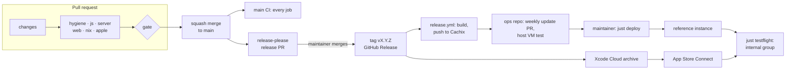

# Software factory

How Shoestring's code is written, checked, released and deployed: the toolchain, the commands, the guard rails, CI/CD, the agent setup and the build order. Nothing is scaffolded yet; this is the target as of 2026-11-08. Facts and measurements come from the research notes, mainly [factory-v2.md](research/factory-v2.md), which replaces the stack-specific parts of [factory-ci-quality.md](research/factory-ci-quality.md). Versions follow the bleeding-edge principle below: those it moved or confirmed were checked on 2026-11-08, and the rest come from the notes. Spike IDs (`SP-…`) are those of [architecture.md](architecture.md#spikes); `F…` spikes are factory-v2's.

**Precedence.** [`PRODUCT.md`](../PRODUCT.md) and the [ADRs](adr/) win, then [`SPEC.md`](../SPEC.md), then this page for tooling, CI, releases and agent setup, while [architecture.md](architecture.md) owns the runtime design; the research notes come last. Tool choices here are technical choices the maintainer delegated (`PRODUCT.md`, Stack), and they replace the toolchain that architecture.md once listed: the flake's devShell plus `just` instead of mise; Biome with GritQL plugins instead of a narrow ESLint config, which returns only if spike F9 fails; release-please instead of git-cliff; tags without release channels; and the layout below.

## Principles

- **Tight feedback loops.** Each check runs as close to the edit as its cost allows: formatting on every edit, `just check-fast` (3-minute budget) when an agent stops, secrets and formatting at commit, the full suite in CI, the simulator's long sweep nightly. Each CI job's checks are one `just ci-<job>` recipe, so a failure reproduces locally with the same command and, through Nix, the same binaries.
- **One required gate.** `gate` is the only required status check: it needs every job, and jobs skip what a change can't affect. Every check that runs blocks, except Biome's `useReactCompiler`, which warns (React Compiler, below); a tool that could only advise waits until a bug or a review shows the gap it would close ([Deferred tools](#deferred-tools)). A red `main` is fixed before anything else merges.
- **Agents as primary authors.** Claude Code and Codex write most of the code, from tickets sized to one session. Conventions live in `AGENTS.md` files and repo skills; checks are deterministic and machine-readable; judgment stays human: French copy, device tests, the maintainer's decisions and every approval. Local hooks help agents; CI and the rulesets are the boundary.
- **Public-repo safety.** Everything pushed is public for good: code, issues, PR screenshots and CI logs. There are no repository secrets, only environment secrets bound to `main` or `v*` tags; no workflow runs on `pull_request_target`; outside contributors' workflows wait for approval; fixtures and screenshots use the test household's generated data; gitleaks (with an IBAN rule), push protection and a personal-terms check stop secrets and personal details; and [`AGENTS.md`](../AGENTS.md)'s public-repository rule keeps people to their roles.
- **Bleeding edge, release candidates at most.** Every dependency and tool tracks its newest stable release or release candidate, never a beta, alpha, canary or nightly. pnpm's 24-hour `minimumReleaseAge` stays, as a supply-chain guard. Dependabot proposes new versions after a 7-day cooldown: monthly for npm, weekly for the rest (Repository settings, below).

## Toolchain and environments

**Pins.** One definition per tool, read the same way on laptops and in CI:

| Pin | Holds (versions of 2026-11-08) | Why |
|---|---|---|
| `flake.lock` → `devShells.default` (the `nixos-unstable` input) | Node 26.13.0, pnpm 12.18.0, PostgreSQL 19 RC1, just 1.59.0, treefmt 2.6, nixfmt 1.5.0, gitleaks 8.30.1, lefthook 2.2.2, squawk 2.70, typos 1.51, actionlint 1.7.12, zizmor 1.32.0, SwiftFormat 0.64.3, Maestro 2.12.1, xcbeautify 3.2.1, CocoaPods, process-compose, jq | The same binaries everywhere; mise would be a second pin file for the same tools. nixos-unstable carried pnpm 12.9.0 and Maestro 2.12.0 on 2026-11-08, so the flake overrides both until it catches up |
| `flake.lock` → `packages.default` and the module (the same `nixos-unstable` input, since 26.11 hasn't branched yet) | Node 26, PostgreSQL 19 and `pnpm_12` for `fetchPnpmDeps` | What self-hosters run; the ops repository builds Shoestring against this lock, never its own nixpkgs |
| `pnpm-lock.yaml` and the workspace catalog | Expo SDK 58 (expo 58.0.23) and React Native 0.88.1 (one version, through the catalog): React Native 0.89.0-rc.0 exists, but no Expo SDK supports it yet, and SDK 59 follows once it reaches RC; react-native-web 0.21.4; TypeScript 7.0.2 (npm `latest`, the native compiler) as `@typescript/native` (`npm:typescript@^7.0.2`) for `tsc -b` and editors, and TypeScript 6 under the `typescript` name (`npm:@typescript/typescript6@^6.0.2`) for the tools that need the compiler API, until they support 7; Hono 5.0.0-rc.1 (npm `next`) with @hono/node-server 2.1.6; Drizzle ORM and drizzle-kit 1.0.0-rc.5 (npm `rc`); Biome 2.6.6, Vitest 5.1.0, fast-check 4.10.2, Playwright 1.65.0, Storybook 10.6.6 (11 is a beta), Terrazzo 2.10.0, FormatJS CLI 6.18.0 | npm moves faster than nixpkgs |
| `.xcode-version` | `27.2` (released 2026-10-29): major.minor, a release or a release candidate, never a beta | Nix can't ship Xcode; Xcode 27.3 is still a beta, so it isn't used |
| `.node-version`, `.pnpm-version` | Mirrors of the devshell's Node and pnpm | For editors and Xcode Cloud; CI fails when they drift |
| `.github/workflows/actions.lock` | Every action, transitive ones included, generated by `gh actions-lock` | Reusable-workflow calls keep full SHAs |
| `apple/Packages/*/Package.resolved`, `Podfile.lock` | Swift packages, CocoaPods pods | Remote Swift dependencies are declared only in local packages; `Pods/` isn't committed |

- **pnpm 12** runs with `minimumReleaseAge` (1,440 minutes), `blockExoticSubdeps`, `trustPolicy: no-downgrade`, an `allowBuilds` list and `pmOnFail: ignore`, which keeps `pnpm-lock.yaml` a single YAML document so that Dependabot alerts work (F11). If a second document ever appears, a weekly OSV-Scanner job replaces the alerts.
- **TypeScript** packages are `composite`, export their source through `exports` and share a base with `@tsconfig/strictest` 2.0.8's flags plus `verbatimModuleSyntax`. Metro, Vite, Vitest and the server bundler read source; `tsc -b` only typechecks. TypeScript 7.0.2, the native compiler, runs `tsc -b` and the editors; tools that need the compiler API keep TypeScript 6 under the `typescript` name, the `@typescript/typescript6` alias, until they support 7 (F4 lists them). TypeScript 7.1 is still a beta, so it isn't used.
- **React Compiler** is on from the start. Biome's nursery `useReactCompiler` reports its diagnostics as warnings, and `eslint-config-expo` returns only if F9 finds gaps. SP-18 still measures hitches and may turn the compiler off.
- **Floors.** iOS 26.0 and watchOS 26.0, which the release checklist runs on iOS 26.0 and watchOS 26.0 simulators, since CI's image carries only 27 runtimes. On watchOS 26.0, complications refresh only while the watch app runs (`SPEC.md` Apple Watch). Web: Safari and iOS 26+ with current Chrome, Edge and Firefox; Node 26 LTS, since Node 27 exists only as an alpha; PostgreSQL 19 only, until 20: 19 RC1 (tag `REL_19_RC1`, 2026-10-12; nixpkgs carries `postgresql_19`), then 19.0 when it ships. Swift 6.4 in Swift 6 mode, warnings as errors. The watchOS 26.0 floor alone would allow the `macos-26` runner, but the `apple` job stays on `xcode-27`, since `macos-26` has no Xcode 27.

**Environments.**

| Environment | What runs there |
|---|---|
| Laptop | The devshell through direnv; Xcode for Apple work; one PostgreSQL cluster per worktree |
| GitHub Actions | Every check: Linux x64 with KVM, macOS on the `xcode-27` label, the Playwright image |
| Xcode Cloud | Release archives, signed by Apple and uploaded to App Store Connect |
| Trial runs | App changes: the test household, locally or on a throwaway instance made from the ops template. Upgrades: a throwaway instance restored from a backup. Infra changes: VM tests, plus a throwaway VPS for provider-specific work |
| Reference deployment | The maintainer's instance, built from the private ops repository (ADR 0003) |

**Local development with Nix.**
1. Install Nix with the 2026 security fixes (2.35.3 or later, 2.34.9 on the 2.34 line, or a patched Lix or Determinate Nix) and flakes on, plus direnv and nix-direnv. On macOS, add Xcode at `.xcode-version`'s major.minor with the iOS 27.0 and watchOS 27.0 simulator runtimes.
2. `direnv allow` loads the devshell from the committed `.envrc` (`use flake`); `just check-env` compares Xcode, Node, pnpm and the simulator runtimes with the pins.
3. `just setup` installs packages and git hooks, creates the worktree's PostgreSQL cluster (Unix socket under `.local/pg`), writes an untracked `Local.xcconfig` with `example.invalid` placeholders and seeds the test household.
4. `just dev` serves the web app and the API on that database in development mode, the only mode that accepts `http://localhost`; `just ios` runs the iPhone app in the simulator.
5. Each git worktree stands alone, with its own cluster, DerivedData under `.build/xcode` and ports, so parallel agents don't collide.
6. NixOS VM tests need x86_64 Linux with KVM: CI, or a Linux machine of your own. A Mac's Linux builder builds packages, but it has no nested KVM and runs x86_64 only through emulation, so VM tests stay in CI. Without Nix, Node and pnpm at the mirrored versions cover TypeScript work, and CI stays the reference (ADR 0018).

## Workspace layout

```text
flake.nix flake.lock justfile .envrc process-compose.yaml  devShell, packages, module, checks, ops template; recipes
package.json pnpm-workspace.yaml pnpm-lock.yaml            workspace, catalog, supply-chain settings, `pnpm spell`
tsconfig.json tsconfig.base.json biome.jsonc treefmt.toml lefthook.yml .gitleaks.toml _typos.toml
.node-version .pnpm-version .xcode-version                 pin mirrors
release-please-config.json .release-please-manifest.json   one product version
AGENTS.md CLAUDE.md PRODUCT.md GLOSSARY.md SPEC.md README.md LICENSE SECURITY.md
.github/              workflows/ (ci, release-please, release, nightly, actions.lock), dependabot.yml, CODEOWNERS
.agents/skills/       repo skills; .claude/skills links here; .claude/settings.json, .codex/hooks.json, .mcp.json
.out-of-scope/        rejected requests, kept by the triage skill
apps/client/          Expo app: iPhone and web, the Mac through the web build; Expo Router routes in src/app
apps/client/ios/      committed Xcode project: app, NSE, watch app, watch widgets, later App Intents; Config/*.xcconfig; ci_scripts/
apps/client/modules/  Swift Expo modules: security, watch-relay
apps/server/          Node service: API, worker and host CLI entry points; migrations/ as reviewed SQL
apple/Targets/        Swift sources of the watch app, widgets, NSE and, later, the App Intents extension
apple/Packages/       DesignSystem and Strings (generated), WatchBridge (glance codec)
packages/             domain, sync-core, connectors, design-system, l10n, test-household
design/               tokens and resolver, components/<Name>/spec.md, icons.yaml; tools/ (Terrazzo plugins, permutation checks)
l10n/                 messages/{en,fr}.json, glossary, French style guide, golden vectors; tools/ (catalog generator)
e2e/                  web/ (Playwright specs), ios/ (the Maestro smoke flow)
tools/                agent/ (hook scripts), ci/ (path filter, Xcode selection, pin checks), biome/ (GritQL plugins), license-check/
nix/                  packages, the services.shoestring module, VM tests, ops template
docs/                 adr/, research/, agents/, architecture.md, factory.md, self-hosting guides
```

- **Dependency direction** ([architecture.md](architecture.md#repository-layout)). `packages/domain` imports no platform; `sync-core`, `connectors` and `test-household` build on it; `apps/server` never imports UI packages, and connector code that calls the data provider runs only there. Swift meets the server only through pinned contracts: the glance's golden JSON, and later the watch actions endpoint (ADR 0006).
- **Generated files** are committed and never edited by hand: design-system themes, `packages/l10n`, `apple/Packages/{DesignSystem,Strings}` and spec enums. CI regenerates them and fails on any diff.
- **`packages/test-household`** is product code: the owner's administration fills test households with it, and unit tests, E2E runs, screenshots and local databases use the same seeded data. Its IBANs carry a reserved invalid checksum, which gitleaks allowlists exactly.
- **`lib.fileset`** in `nix/` keeps client-only and Xcode changes from rebuilding the server.
- **Permanent identifiers** (bundle IDs, app group, Keychain groups, URL scheme) come only from `apps/client/ios/Config/*.xcconfig`: a committed example under `example.invalid`, an untracked local copy, and Xcode Cloud environment variables for the maintainer's builds. CI builds the simulator app from the example, and self-hosters build from their own copy (ADR 0019).
- **Spike code** lives on `spike/<id>-<slug>` branches that never merge; the ticket records the generic result, and results about household devices, banks, networks or members stay in the private ops repository (architecture.md Spikes).

## Commands

| Command | Does |
|---|---|
| `just setup` | First run in a clone or worktree: `pnpm install --frozen-lockfile`, `lefthook install`, the PostgreSQL cluster, `Local.xcconfig`, the test-household seed |
| `just check-env` | Compares Xcode, Node, pnpm and simulator runtimes with the pins |
| `just dev` | process-compose: PostgreSQL, migrations, API and worker in watch mode and development mode, Expo's web dev server |
| `just ios [route]` | Debug build with `xcodebuild`, the pinned simulator, Metro, then a deep link to the route |
| `just db`, `just db-reset`, `just seed` | Start or recreate the worktree's database; regenerate the test household from its seed |
| `just fmt` | treefmt over the tree |
| `just check-fast` | The stop hook: `tsc -b`, Biome on changed files, related Vitest tests, plus `swift test`, squawk, `l10n-check` or `ds-check` when their paths changed |
| `just check` | `ci-hygiene`, `ci-js` and `ci-server`: everything but E2E, VM tests and Apple builds |
| `just ci-<job>` | Exactly what CI job `<job>` runs: `hygiene`, `js`, `server`, `web`, `nix`, `apple` |
| `just test [filter]`, `just test-int` | Vitest; server integration tests on the local database |
| `just e2e-web`, `just e2e-ios` | Playwright against the exported web app and a seeded server; the Maestro smoke flow on the Debug build |
| `just apple-test` | `swift test` on `apple/Packages`, and the watch scheme on watchOS 27.0 |
| `just l10n`, `just ds-build` | Regenerate strings or tokens and everything generated from them; `l10n-check` and `ds-check` verify without writing |
| `just build`, `just build-web` | `nix build` of the server package (API, worker, host CLI, web build, migrations); `expo export --platform web` |
| `just vm-test [name]` | One NixOS VM test, on x86_64 Linux with KVM |
| `just release-check` | The release PR's state, days since the last `v*` tag against TestFlight's 90 days, the release checklist |

Recipes call package scripts, never the reverse, and re-enter the devshell when `IN_NIX_SHELL` is unset. Package scripts stay few: `test` in every package; `start`, `web`, `export:web` and `storybook` in `apps/client`; `dev:api`, `dev:worker`, `cli` and `db:draft` (drizzle-kit drafts a migration for review) in `apps/server`; `spell` (typos) at the root, which the `ship` skill looks for.

Nothing releases or deploys from this repository's command line. Merging release-please's PR makes a release, and the ops repository's `justfile` deploys: `just install <ip>` (nixos-anywhere and disko, then a harmless deploy-rs deploy), `just deploy` (deploy-rs from a workstation, a Mac included, building the system on the VPS from cached packages), `just testflight` (adds the release's build to the internal group once the instance runs it), `just rollback` and `just ssh`.

## Guard rails

*Edit* is the format-on-edit agent hook and *Stop* is `just check-fast`; git hooks come from lefthook. Every row blocks, except `useReactCompiler`'s warnings.

| Tool | Version | Scope | Agent hook | Git hook | CI |
|---|---|---|---|---|---|
| treefmt: Biome, nixfmt, SwiftFormat | 2.6; 2.6.6, 1.5.0, 0.64.3 | Every formatted file | Edit | `pre-commit` | `hygiene` |
| Biome lint: recommended preset, `reactNative` domain, nursery `useReactCompiler` as a warning | 2.6.6 | TS, JS, JSON, CSS | Stop | — | `hygiene` |
| GritQL plugins: raw style values (deny by default), `style` props outside the design system, literal JSX text | In-repo | `apps/client`, `packages/design-system`; the JSX-text plugin skips stories and tests | Stop | — | `hygiene`, once F9's fixtures pass |
| `tsc -b` with strictest flags | TypeScript 7.0.2 | All TypeScript | Stop | — | `js` |
| Swift compiler: Swift 6 mode, warnings as errors | Swift 6.4, Xcode 27.2 | Swift targets | — | — | `apple` |
| Vitest | 5.1.0 | Packages, server, tools | Stop (related) | — | `js` |
| Sync simulator: seeded fast-check model runs with faults | 4.10.2 | `packages/sync-core`, mutators | Stop (related) | — | `js` (fixed seeds); nightly (100,000+, opens an issue) |
| Server integration tests | Vitest 5.1.0, PostgreSQL 19 RC1 | `apps/server`, `packages/connectors` | — | — | `server` |
| squawk; migration drift against the Drizzle schema; each migration's floor declared | 2.70; drizzle-kit 1.0.0-rc.5 | `apps/server/migrations/` | Stop (when changed) | — | `server` |
| Connector contract kit against a fake data provider | In-repo | `packages/connectors` | — | — | `server` |
| `just l10n-check`: ICU subset, `formatjs verify`, French typography, length budgets | FormatJS CLI 6.18.0 | `l10n/` and generated catalogs | Stop (when changed) | — | `js` |
| `just ds-check`: regeneration drift, contrast in the five permutations, spec parity, icon map | Terrazzo 2.10.0, culori 4.0.2 | `design/` and generated outputs | Stop (when changed) | — | `js` |
| Storybook build: the documented component library | 10.6.6 | Design-system stories on the web | — | — | `web` |
| Playwright E2E with axe | 1.65.0, axe-core 4.14.0 | The web app in Chromium, WebKit and Firefox | — | — | `web` |
| Maestro smoke flow | 2.12.1 | The iOS Debug build | — | — | `apple` |
| `swift test`, watch `xcodebuild test` | Xcode 27.2 | `apple/` | — | — | `apple` |
| `nix flake check`: packages and NixOS VM tests | `runNixOSTest` | `nix/` and the package | — | — | `nix` |
| gitleaks with an IBAN rule; the generator's reserved IBANs allowlisted, a valid-checksum IBAN still refused | 8.30.1 | Staged changes, PR diff, history | — | `pre-commit` | `hygiene`; nightly (history) |
| Personal-terms check against a denylist kept outside the repository (`.git/info/personal-terms`) | In-repo script | Staged files | — | `pre-commit` | — |
| Secret scanning and push protection | GitHub | Every push | — | — | GitHub |
| License check and third-party notices: permissive or MPL only (ADR 0013) | In-repo, over `pnpm licenses list` | App build closure, pods, Swift packages | — | — | `hygiene` (dependency changes) |
| `expo install --check`, `expo-doctor`, one `react-native` | Expo SDK 58 | `apps/client` dependencies | — | — | `js` (dependency changes) |
| typos | 1.51 | Code and English docs | — | `pre-commit` | `hygiene` |
| zizmor, actionlint, `actions.lock` | 1.32.0, 1.7.12 | `.github/` | — | — | `hygiene` |
| Conventional Commit PR title, read through `env` | In-repo | PR titles | — | — | `hygiene` |
| Pin mirrors | In-repo | `.node-version`, `.pnpm-version`, the one-document lockfile | — | — | `hygiene` |
| CodeQL default setup, blocking on high and critical alerts | GitHub | JavaScript/TypeScript and workflows, no Swift | — | — | GitHub and the ruleset |
| pnpm supply-chain settings; Dependabot | pnpm 12; 7-day cooldowns | Every install; npm, swift, nix, actions | — | — | Install; Dependabot PRs pass `gate` |
| Rulesets on `main` and `v*` | GitHub | Merges, tags | — | — | GitHub |
| Deny rules (a convenience, not a boundary) | Claude Code settings | Agent Bash calls | Every call | — | — |

### Deferred tools

Each comes back when a bug or a review shows the gap it closes, with its pin, its CI cost and its agent instructions added in the same pull request: Biome's nursery `noFloatingPromises`; SwiftLint and its token rules, once watch components exist; statix and deadnix; Jest with jest-expo and React Native Testing Library; Storybook's Vitest and a11y addons and its MCP server (F7); Playwright screenshot baselines; React Native Harness image snapshots; `ImageRenderer` diffs; XCUITest accessibility audits and launch and hitch metrics; Maestro flows beyond the smoke flow; coverage floors; knip; impeccable detect; Periphery; OpenSSF Scorecard; OSV-Scanner unless F11 fails.

## CI/CD

Every workflow starts with `permissions: {}` and grants each job the least it needs; checkout uses `persist-credentials: false`; untrusted text such as PR titles reaches scripts only through `env:`. Jobs that use the devshell install Nix with `cachix/install-nix-action` v31.11.3 and Magic Nix Cache (action v15, daemon pinned with `source-tag`), then run one `just ci-<job>`. Budgets (SP-16): a TypeScript-only PR under 10 minutes, a native PR under 30.

**Pull requests** (`ci.yml` on `pull_request`, cancelling superseded runs of the same ref):

| Job | Runner | Runs when | Does |
|---|---|---|---|
| `changes` | `ubuntu-slim` | Always | Diffs against the merge base and emits path outputs |
| `hygiene` | `ubuntu-24.04` | Always | treefmt `--ci`, Biome and its plugins, gitleaks on the diff, typos, zizmor, actionlint, the PR title, pin mirrors; the license check when dependencies change |
| `js` | `ubuntu-24.04` | TypeScript, `design/`, `l10n/` or the lockfile changed | `tsc -b`, Vitest with the simulator's fixed seeds, `l10n-check`, `ds-check`; `expo install --check` when dependencies change |
| `server` | `ubuntu-24.04` | Server, domain, sync-core or connector code, or migrations changed | PostgreSQL 19 RC1 from the devshell, integration tests, squawk, migration drift, the contract kit |
| `web` | Playwright `v1.65.0-noble` image, a `postgres:19rc1` service | Client, design-system, `l10n/`, `e2e/` or server code changed | `expo export` with `web.output: single`, a server in development mode seeded with the test household, E2E with axe in three browsers, the Storybook build. The one job outside the devshell (Node and pnpm from the mirror files), so later baselines keep the image's fonts |
| `nix` | `ubuntu-24.04` (x64, KVM) | Anything the package or module builds from | `nix flake check -L`: packages, VM tests (fresh install, upgrade from the previous release, rollback to it, backup then wipe then restore, public interface closed), nixfmt |
| `apple` | `xcode-27` | `apps/client/ios/`, `apps/client/modules/`, `apple/`, native dependencies or `.xcode-version` changed, or the `ios-ci` label | Selects Xcode from `.xcode-version` and refuses betas; `pod install`; a Debug simulator build with placeholder signing; `swift test`; watch tests on watchOS 27.0; the Maestro smoke flow |
| `gate` | `ubuntu-slim` | `if: always()` | Needs every job above and fails when one failed or was cancelled |

**`main`** (`ci.yml` on `push`): every job whatever the paths, `apple` included. Only `main` runs write caches: the Nix store through Magic Nix Cache, the pnpm store keyed on the lockfile, `Pods/` keyed on `Podfile.lock` and the `.tsbuildinfo` files, all keyed by OS and architecture within the 10 GB budget. `release-please.yml` updates the release PR.

**Nightly** (`nightly.yml`): 100,000+ simulator seeds, full-history gitleaks and, once a connector exists, an Enable Banking sandbox smoke test (the `nightly` environment). A failure opens or updates an issue labelled `needs-triage`.

**Releases.**
- **Version.** One SemVer for the product. release-please 17.11 (action v5.0.0) runs with the release GitHub App's token from the `release` environment, so its PR triggers CI. It reads squash-merged PR titles and keeps one release PR that bumps every `package.json`, `apps/client/ios/Config/Version.xcconfig` (`MARKETING_VERSION`) and `CHANGELOG.md`. No changesets.
- **Tag.** Merging the release PR creates the tag `vX.Y.Z` and its GitHub Release. `release.yml` runs on the tag with `cache-mode: none`: it checks that the tag points at a release-please commit on `main`, builds the server package and pushes it to the project's public Cachix cache. The release notes say whether its migrations raise the schema floor ("rollback needs a restore", ADR 0018). Once the server is stable (SP-33) it also builds the image for amd64 and arm64 with `buildLayeredImage`, pushes it to GHCR by digest, attests it and attaches the compose bundle.
- **No channels.** A `vX.Y.Z` tag is the release, `main` is development, and tags never move (ADR 0018). A minor that needs a trial run gets one on a throwaway instance restored from a backup, since migrations are instance-wide.
- **TestFlight.** An Xcode Cloud workflow archives each `vX.Y.Z` tag (ADR 0019) and uploads it to App Store Connect, where the internal group's automatic distribution stays off. `ci_post_clone.sh` installs Node and pnpm at the mirrored versions, then runs `pnpm install --frozen-lockfile` and `pod install`; `ci_pre_xcodebuild.sh` stamps `CI_BUILD_NUMBER` on every target, since the watch's build number must match the app's; `ci_post_xcodebuild.sh` writes What to Test from the changelog. The build joins the internal group only after the reference instance reports the release at `/api/v1/meta`: through the ops repository's `just testflight`, with an App Store Connect API key, or by hand. A release ships at least every 90 days, before builds expire. No macOS archive, EAS or fastlane in v1; if F1 fails, `xcodebuild` with an App Store Connect key from the `testflight` environment is the fallback.

**Deploys** (the private ops repository, ADR 0003). The ops repository pins Shoestring to a release tag. A weekly workflow looks up the latest release (`gh release view --json tagName`), points the Shoestring input at it, runs `nix flake update` (nixpkgs follows `nixos-unstable`, so the host takes rolling updates) and the host VM test on 2-CPU private runners, and opens a PR: an update PR, not an unattended deploy. After merging it, the maintainer runs `just deploy`, which substitutes the release package from Cachix and deploys with magic rollback, then `just testflight`. Deploys stay by hand for now: the ops CI holds no deploy credential, since CI deploys would need GitHub Pro on the ops repository.



**Repository settings.**
- **`main-checks` ruleset**, with no bypass: the `gate` check, not strict (without a merge queue, strict mode reruns the macOS job after every merge), so semantic conflicts surface in `main` CI and are fixed forward on `main`; code scanning results, blocking on high and critical alerts; linear history; no force push or deletion.
- **`main-review` ruleset**: a pull request with one approval, stale approvals dismissed, the latest push approved and Code Owners review (`.github/CODEOWNERS`: `* @<maintainer>`); resolved conversations; squash only. The repository admin role may bypass it for pull requests only, so the maintainer merges their own PRs, which still pass `main-checks`.
- **`v*` tag ruleset.** No update or deletion, for anyone. Creation stays open to writers, since no ruleset bypass can be relied on for the release App on a personal repository: `release.yml` refuses a tag that isn't a release-please commit on `main`, the ops repository follows GitHub Releases rather than bare tags, and an archive reaches devices only through `just testflight`.
- **Merges.** Squash commits take the PR title only, so breaking changes mark the title with `!`; head branches are deleted after merge.
- **Actions.** Approval for every external contributor's workflows; a read-only `GITHUB_TOKEN`; Actions can't create or approve PRs; full-SHA pinning required, which `actions.lock` satisfies.
- **Security.** Secret scanning and push protection (already on); private vulnerability reporting with `SECURITY.md`; Dependabot alerts and security updates; CodeQL default setup for JavaScript/TypeScript and Actions, with Swift deselected. CodeQL can't analyze Swift built with Xcode 27, so Swift has no SAST for now: the compiler's strict mode, tests, the pinned contracts and the maintainer's review of the `Security` module cover it, and each CodeQL release is rechecked.
- **Environments**, the only place secrets live: `release` (`main` and `v*` tags: the release App's ID and key, the Cachix token), `nightly` (`main`: sandbox credentials), `testflight` (`v*` tags, the maintainer's approval, fallback only).
- **Dependabot.** `npm` monthly, in one group; `swift`, `nix` and `github-actions` weekly and grouped; `cooldown.default-days: 7`. It ignores `expo`, `expo-*`, `react`, `react-native` and Expo-managed libraries, which `upgrade-expo-sdk` moves together. The `nix` job prints the new pnpm hash for an npm PR, and `fix-dependency-pr` commits it.

## Agent setup

**`AGENTS.md`.** The root file stays under 4 KiB and each nested one under 2 KiB, since Codex reads at most 32 KiB from the root down to the working directory. Each directory with an `AGENTS.md` also gets a one-line `CLAUDE.md` holding `@AGENTS.md`, as the root does. Sections for the maintainer to add to the root, beside the current Public repository and Agent skills sections:
- **Read first** (now): `PRODUCT.md`, `SPEC.md`, `GLOSSARY.md`, `docs/adr/`, `docs/architecture.md` (map), this page (tooling), the precedence order, and "`docs/research/` is background: follow a note only where an ADR, `SPEC.md`, architecture.md or this page adopts it".
- **Pull requests and tickets** (now): titles are Conventional Commits, which become the squash commit; the body carries `Closes #<n>`; spike results about household devices, banks, networks or members stay in the private ops repository.
- **Commands** (once the scaffold exists): `just setup`, `just dev`, `just check-fast`, `just check`, `just ci-<job>`, `just e2e-web`, `just e2e-ios`; `ship` validates with `just check`.
- **Layout**: one line per root, pointing to this page.
- **Invariants**: money in integer minor units, never a float or a `bigint` in TypeScript; time in the household time zone (ADR 0017); glossary terms; tokens and design-system components only; every string in `l10n/messages/en.json` and `fr.json`; expand/contract migrations that declare their floor, and never an edit to a merged one; client schema changes keep the outbox; synthetic fixtures only; generated files never edited by hand; never `expo prebuild`; permanent identifiers only from config.
- **Definition of done**: the list under Work management.
- **Release policy**: no changesets; release-please reads squash-merged PR titles.
- **Hooks**: Codex skips new or changed repo hooks until the maintainer trusts them in `/hooks`, so a PR that changes `.codex/hooks.json` says so.

Nested files add each area's commands and pitfalls:

| Path | Adds |
|---|---|
| `apps/client/` | Expo Router routes; `.ios.tsx` and `.web.tsx` for system controls; generated string accessors; Expo-managed dependencies move only with `upgrade-expo-sdk`; `run-app` for screenshots |
| `apps/client/ios/` | The project is owned in Xcode; targets and xcconfig layout; build numbers come from Xcode Cloud; `Pods/` stays untracked; DerivedData per worktree |
| `apple/` | Swift 6 mode; generated `DesignSystem` and `Strings` code; `WatchBridge` pinned by the glance's golden JSON; `swift test` |
| `apps/server/` | `add-migration`; one `can(person, action, record)` check per mutation; never log payloads, tokens or bank identifiers; `just db` |
| `packages/domain/`, `packages/sync-core/` | No platform imports; golden vectors; `add-mutation`; the simulator must pass; one writer per local copy; a client schema change keeps the outbox, re-bootstraps the rest, and passes the N−1 upgrade test on both SQLite drivers |
| `packages/connectors/` | Synthetic fixtures and the capture scrubber; the contract kit; no provider key in code or logs |
| `design/`, `l10n/` | A spec before a component; token tiers and names; the ICU subset, `vous`, the glossary and the French style guide |
| `nix/` | A VM test for every module change, and for SSH, firewall or Tailscale edits one that logs in over the new path; never change `stateVersion`; the pinned channel's manual, not memory; no secrets in Nix strings |

**Hooks**, scripts in `tools/agent/`:

| Hook | Claude Code (`.claude/settings.json`) | Codex (`.codex/hooks.json`) |
|---|---|---|
| Session start | `env.sh` writes the devshell's environment into `CLAUDE_ENV_FILE`, so every Bash call has the pinned tools and `PG*` variables | None: Codex starts inside the devshell through direnv |
| After an edit | `PostToolUse` on `Edit\|Write`: `format.sh` runs treefmt on the file; exit 2 shows its errors | `PostToolUse` on `apply_patch\|Edit\|Write`: the same script |
| Stop | `stop.sh` exits 0 when `stop_hook_active` is set, otherwise runs `just check-fast` and exits 2 with the failures; 300 s timeout | The same script, allowing one retry |

lefthook's `pre-commit` runs treefmt on staged files, `gitleaks git --pre-commit --staged --redact`, typos and the personal-terms check, which also catches files an agent rewrote through Bash. Claude Code denies, as a convenience rather than a boundary: `git commit --no-verify`, `git push --force`, pushes to `main`, `gh pr merge --admin`, `gh pr review`, `gh auth`, `gh api` calls on rulesets, `gh secret`, `git credential`, `security find-generic-password` and `find-internet-password`, `expo prebuild`, `pod deintegrate` and `nix flake update` (Dependabot owns lock bumps).

**Identity.** Agents push, open PRs and comment as a GitHub machine account (one free per person), invited with write access and holding a classic token with the `repo` and `workflow` scopes, since fine-grained tokens can't reach a personal account's repository as a collaborator. Agent sessions get that token through `GH_TOKEN`, a `GH_CONFIG_DIR` that holds only the machine account, and a git credential helper that returns its token, never through the repository. Where agents run on the maintainer's own macOS user, the maintainer's `gh` login and keychain stay within reach, so there the machine account is a convention, not a boundary. The deny rules support it but don't enforce it. It is a boundary only for agents that hold the machine token alone, in the cloud or under a separate user account.

**MCP servers.** Start with agent-device 0.21.36 (taps, text entry, snapshots and screenshots on simulators; T3 Code's device panel drives it too) and Playwright MCP 0.0.84 (drives the web app), at exact versions in `.mcp.json` (Claude Code) and the maintainer's Codex configuration. MobileBuildMCP, Xcode's `mcpbridge`, mcp-nixos and Storybook's MCP addon wait until a task needs them. Expo's MCP server isn't used: it needs an Expo account, and its doc search a paid Expo subscription.

**Repo skills.** A repo skill is written once a task has been done by hand two or three times, in `.agents/skills/` (Codex) with `.claude/skills` linking to it (Claude Code). `run-app` and `add-mutation` come first. Candidates:

| Skill | Purpose |
|---|---|
| `run-app` | Boot the pinned simulator or a browser, seed the test household, open a screen by deep link, return screenshots in light and dark, en and fr |
| `add-mutation` | Add a named, versioned mutation in `packages/domain` with golden vectors, a simulator command, the server handler and a test from an app of the previous minor |
| `add-migration` | Take a server schema change through a drizzle-kit draft, expand/contract review and its floor, squawk, an upgrade fixture and the VM upgrade and rollback tests |
| `add-component` | Go from `design/components/<Name>/spec.md` to the React Native component with `.ios`/`.web` variants and stories and, when the spec lists watchOS, the SwiftUI subset |
| `add-strings` | Add keys to `en.json` and `fr.json` following the glossary and style guide, run `just l10n`, put an EN/FR table in the PR |
| `add-connector` | Add a connector on the SDK interface: manifest, contract kit against the fake data provider, synthetic golden files, capture scrubber |
| `test-household` | Extend the seeded generator, so that one seed always gives the same household |
| `fix-dependency-pr` | On a Dependabot PR, write the `fetchPnpmDeps` hash the `nix` job printed, run `expo install --check`, push one commit marked `[dependabot skip]` |
| `upgrade-expo-sdk` | Prebuild in a throwaway copy, diff it against `apps/client/ios/`, port the native changes, run the iOS suite; the maintainer tests on devices |
| `release` | Check the release PR, the 90-day TestFlight clock, the paired-device watch checklist and the ops-repo bump |

## Work management

GitHub Issues on this repository are the only tracker ([issue-tracker.md](agents/issue-tracker.md)), and everything in them is public. The planning skills come from the maintainer's own skill set (based on mattpocock/skills), not from this repository: `wayfinder`, `to-spec`, `to-tickets`, `triage` and `implement` can be started only by a person, through their slash command, while agents run `tdd`, `code-review` and `ship` themselves. A contributor or a cloud agent without those skills works from the issue directly; the rules they rely on (`Closes #<n>`, Conventional squash titles, the definition of done) belong in `AGENTS.md`, so any tool follows them.

1. **`wayfinder`** (the maintainer) charts a large effort as a `wayfinder:map` issue whose child tickets are decisions: `research` (resolved by the `research` skill on a throwaway `research/<name>` branch), `prototype`, `grilling` (with `grilling` and `domain-modeling`) and `task`. Each spike becomes a ticket on the relevant map, titled with its ID (`SP-03: …`) and carrying architecture.md's pass criteria; spikes that need the household's devices, banks or members are labelled `ready-for-human`; settled decisions become ADRs. Each open question of `SPEC.md` and of this page becomes one `needs-info` issue.
2. **`to-spec`** (the maintainer) turns a settled discussion into a spec issue labelled `ready-for-agent`, with its test seams agreed.
3. **`to-tickets`** (the maintainer) cuts the spec into vertical slices, published as sub-issues with native blocking links, each sized to one agent session and labelled `ready-for-agent`.
4. **`triage`** (the maintainer) moves everything else (bug reports, requests, nightly failures) through the triage roles, writes agent briefs and records rejected ideas in `.out-of-scope/`.
5. **`implement`** (the maintainer starts it; the agent then works alone) claims one ticket, works test-first with **`tdd`** at the agreed seams, runs typechecks and tests, reviews the result with **`code-review`** (standards and spec, in parallel) and commits.
6. **`ship`** (agents) runs `just check`, makes Conventional commits and opens the PR. Its issue argument is a Linear ID, so the `Closes #<n>` line comes from the `AGENTS.md` rule. `gate` runs, the maintainer approves an agent's PR, and the squash title feeds release-please.

Design prototypes, from Claude Design through `/design-sync` or from Figma, enter as a change to a component's `spec.md`, followed by `add-component`.

**Labels**, created in slice 0:

| Labels | Meaning |
|---|---|
| `needs-triage`, `needs-info`, `ready-for-agent`, `ready-for-human`, `wontfix` | Triage states ([triage-labels.md](agents/triage-labels.md)) |
| `bug`, `enhancement` | Triage categories |
| `wayfinder:map`, `wayfinder:research`, `wayfinder:prototype`, `wayfinder:grilling`, `wayfinder:task` | Maps and decision tickets, which carry no other label |
| `ios-ci` | Runs the `apple` job on a PR whose paths wouldn't |
| `dependencies` | Dependabot's PRs |
| `autorelease: pending`, `autorelease: tagged` | release-please's own |

**Definition of done.** A ticket closes when its PR merges and:
- the PR links the issue with `Closes #<n>`, and its title is a Conventional Commit;
- tests came first at the agreed seams, and a fix starts from a failing test;
- `just check` passed locally and `gate` passed in CI;
- UI uses design-system components and tokens only, with screenshots of the test household in light and dark, en and fr;
- every new string exists in en and fr, and the maintainer reviewed the French;
- server schema changes are expand/contract, declare their floor and pass squawk and the upgrade and rollback VM tests; client schema changes keep the outbox and pass the N−1 upgrade test on both SQLite drivers; new mutations are versioned and pass the simulator;
- glossary terms are used, and ADRs, `SPEC.md` or architecture.md changed with any decision;
- the diff holds no secret, personal detail or real bank data;
- a change to `.codex/hooks.json` is called out, and the maintainer trusts it in `/hooks` after the merge;
- an agent's PR has the maintainer's approval as code owner.

## Build order

Each slice ships something the household can use and pulls in only the factory setup and spikes it needs; the rest waits. Steps marked *(maintainer)* need the maintainer's accounts, devices or settings. `SPEC.md` defines what each slice must do.

0. **A safe repository** (one session, before any code).
   - Before the first commit: the research notes carry no personal passages; `docs/research/naming.md` stays in `.git/info/exclude`, and only the decision is committed, as ADR 0020; `.git/info/personal-terms` lists the terms to refuse; and `AGENTS.md` has its Read first and Pull requests sections ([Agent setup](#agent-setup)).
   - Add `LICENSE` (MIT), `SECURITY.md` and `.github/CODEOWNERS`; a minimal `flake.nix` devShell and `.envrc`; a `justfile` with `fmt`, `check` and `ci-hygiene`; `treefmt.toml`; a root `package.json` with Biome; `lefthook.yml` with gitleaks, typos and the personal-terms check; `.gitleaks.toml` with the IBAN rule.
   - Add `ci.yml` with `changes`, `hygiene` and `gate`, plus `.github/workflows/actions.lock` from `gh actions-lock`.
   - Merge all of it, with `AGENTS.md`, `CLAUDE.md`, `PRODUCT.md`, `GLOSSARY.md`, `SPEC.md` and `docs/` (naming.md excepted), as the first PR. *(maintainer)* Then set up the machine account, and turn on the repository settings, the `main-checks` and `main-review` rulesets, CodeQL default setup and the labels.
   - Done when a PR whose `gate` fails can't merge, and a staged IBAN with a valid checksum, or a denylisted term, is refused at commit, the IBAN in CI too.
1. **A plan on two devices.** One household, a cash account, manual entries and one personal plan with allocation, safe to spend and the daily budget, synced between the web app and the iPhone simulator under `just dev`, with a development-only sign-in (F6).
   - Adds: the TypeScript workspace (catalog, supply-chain settings, `tsconfig` bases, the GritQL plugins with F9's fixtures); `packages/domain` and `packages/sync-core` with the simulator; `apps/server` with Hono, Drizzle, `just db`, squawk and the drift check; `apps/client` exporting the web app; the token pipeline and the catalog generator, web outputs first; Storybook as the component library; `e2e/web`; a first `packages/test-household` seed for fixtures and screenshots; one `expo prebuild` and the committed `ios/` with the app target only; the `js`, `server`, `web` and `apple` jobs with the Maestro smoke flow; the license check; the agent hooks and the root `AGENTS.md` Commands and Layout; Dependabot for npm and Actions.
   - Spikes: SP-08, SP-09, the web halves of SP-15 and SP-19, SP-17 without the watch, SP-27, SP-29; SP-18 starts on the simulator.
   - Done when an entry made offline on the web shows once on the iPhone after both sync, in English and French, light and dark, and the simulator's fixed seeds pass in CI.
2. **Imports and the review inbox.** OFX, QIF and CSV import with the supported banks' profiles, the review inbox and categorization rules, transfer and cash-withdrawal detection, recurring items and the forecast, goals, limits and in-app alerts, and the test household's generator.
   - Adds: `packages/connectors` with the parsers and synthetic golden files; the full test-household generator and the owner's "fill with generated data".
   - Spikes: SP-14, SP-20. *(maintainer)* SP-05's install starts on a throwaway VPS.
   - Done when overlapping exports land once and fill the inbox with category, payee and attribution suggestions.
3. **Two members and the shared plan.** Invites, visibility, the shared plan and its split, money owed and the net-cost rule.
   - Spikes: SP-28 *(maintainer)*.
   - Done when `SPEC.md`'s acceptance criteria for money owed, shared plans and sharing pass in the simulator and in both apps.
4. **The household's instance.** Passkeys, the app lock and step-up; the package, the module and its VM tests; the ops repository and the tailnet host; backups and restore; alerts and reminders by APNs and Web Push; releases and the first TestFlight build.
   - Adds: `packages.default`, `nixosModules.default`, `templates.ops` and the `nix` job; the release App, release-please, `release.yml` and the Cachix cache; the NSE target; *(maintainer)* the app record, household members as App Store Connect users (ADR 0019), Xcode Cloud's repository connection and workflow, and the first internal build (F1).
   - Spikes: SP-03, SP-04, SP-05, SP-06 *(maintainer)*, SP-10, SP-11, SP-16, SP-21, SP-24, SP-25, SP-26.
   - Done when the household uses the tailnet instance from TestFlight builds and the web app, and a restore check passes.
5. **Bank connections.** The owner's provider application, consent and renewal, refresh slots and the fetch budget, the fake-provider contract kit and the nightly sandbox test. Other members import files.
   - Spikes: SP-12 and SP-13 *(maintainer)*.
   - Done when a week of background refreshes at each supported bank stays within the budget without a rate limit.
6. **The watch.** The watch target with the read-only glance and one complication family; GlanceBuilder, `GET /api/v1/glance` and WatchRelay.
   - Spikes: the Apple halves of SP-15 and SP-19, SP-17's watch part, SP-22 and SP-31 *(maintainer)*.
   - Done when the watch shows both plans' figures with the glance's age within `SPEC.md`'s budgets.

After the MVP, and only on evidence: the [deferred tools](#deferred-tools), repo skills beyond the first two, Next's features, and the image and compose bundle once the server is stable (SP-33).

## Costs

| Item | Cost | Note |
|---|---|---|
| GitHub Free on the public repository: hosted runners (macOS included), Actions cache, CodeQL, secret scanning, Dependabot, public GHCR packages | $0 | Standard runners are free and unlimited on public repositories, with 20 concurrent jobs, 5 of them macOS |
| Actions on the private ops repository | $0 | Within GitHub Free's $12 a month of included compute, about 2,000 2-CPU Linux minutes; a weekly VM test uses a small part (estimate) |
| Apple Developer Program | $99 a year | Needed for TestFlight anyway |
| Xcode Cloud | $0 | 25 compute hours a month included; about 25 minutes per archive, so 8 releases use about 3.3 hours (estimate) |
| Cachix | $0 | 5 GB free for open source; holds the release packages the VPS downloads |
| Tailscale | $0 | Members join the owner's tailnet; a household stays within the free plan (unverified: check its current user limit) |
| Machine account, Magic Nix Cache, Healthchecks.io | $0 | One free machine account per person; Healthchecks' free tier has 20 checks |
| GitHub Pro on the ops repository | $4 a month, optional | Only for CI deploys |

Total: $0 a month plus $99 a year, and $4 a month more with CI deploys. Not counted: agent subscriptions, the VPS, the domain and backup storage. Not used: EAS, Chromatic, Codecov, a Turborepo remote cache and Expo's paid MCP doc search.

## Open questions

**For the maintainer.** No tooling question is open. A new one becomes one `needs-info` issue, recommendation first; product questions are in [`SPEC.md`](../SPEC.md#open-questions).

**Spikes this plan depends on** (F1 is part of SP-03, F2 and F3 of SP-16):
- F1: Xcode Cloud archives the committed project from the pnpm monorepo, starts on the tags release-please creates, and gives every target the same build number.
- F2, F3: the `apple` job's time, memory and disk on the hosted runner (7 GB of RAM, 14 GB of disk); Nix on macOS runners, and the caches' footprint against 10 GB.
- F4: list the tools that need the TypeScript compiler API, which keep TypeScript 6 under the `@typescript/typescript6` alias until they support 7.
- F5: `expo export` inside a Nix derivation.
- F6: a Debug-only E2E sign-in path for Maestro and Playwright that leaves Release builds unchanged.
- F8: how often Dependabot PRs break the Nix pnpm hash, and whether `fix-dependency-pr` keeps up.
- F9: deny-by-default GritQL plugins with fixtures for every known miss; `useReactCompiler` against `eslint-config-expo`'s compiler rules.
- F11: `pmOnFail: ignore` keeps the lockfile a single document and Dependabot alerts working.
- Deferred with its tools: F7 (Storybook's Vitest addon and Harness stability).

**Unverified:** KVM on `ubuntu-24.04-arm`; whether tags that release-please creates through the API start workflows and Xcode Cloud (F1); whether an internal TestFlight group's automatic distribution can stay off for Xcode Cloud uploads; every minute and hour estimate on this page.
